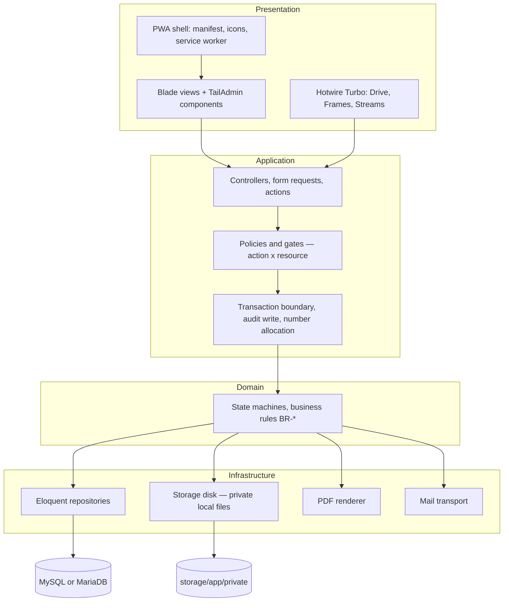

# WJ-CCTV Business Operations System

A centralised, auditable business operations platform for **WJ-CCTV.com** — covering project delivery, field technicians, procurement, project-based material control, document management, and operational finance.

**Current status: documentation phase. No application code exists.**

---

## 1. Purpose

WJ-CCTV.com provides CCTV-related services and other business services. Operations currently run on Excel/Google Sheets, Word, and WhatsApp, with no centralised inventory and no reliable audit trail.

This system replaces that with a single system of record that answers, with evidence:

- What was promised to the customer, and what was delivered?
- What materials were needed, what was actually available, what was purchased, and what was used?
- Who approved a purchase, and did the money actually move?
- When did technicians actually work, and who verified the result?
- What was invoiced, at what number, and what has been paid?
- Who changed what, and when?

The immediate business driver is a **confirmed invoice-numbering conflict** whose cause is unconfirmed. Eliminating internal duplicate numbering is a first-class requirement, not a side effect.

---

## 2. Current status

| Aspect | Status |
|---|---|
| Repository contents | Documentation only |
| Application code | **None** |
| Technology stack | **Not installed.** Client-mandated baseline recorded — see [ADR-008](./docs/decisions/ADR-008-laravel-platform-baseline.md) |
| Build / test / run commands | **None exist** |
| Dependencies | None |
| Configuration files | None (`composer.json`, `package.json`, lockfiles, `.env` deliberately absent) |
| Git repository | Present — branch `main`, remote `origin` → `https://github.com/tupski/WJC-BMS.git` |
| Implementation | **Not started** — awaits authorisation |

**Repository state (measured 2026-10-25):** `git rev-parse --is-inside-work-tree` → `true`; branch `main`; working tree clean; `origin` fetch/push → `https://github.com/tupski/WJC-BMS.git`.

The client states the project is hosted at GitHub `tupski/WJC-BMS` — **[Confirmed] as a client statement**, corroborated by the configured remote. **No network access was available while authoring this set**, so remote branch state, commit SHAs, and hosted artefacts are **unverifiable offline** and are not asserted anywhere in these documents.

Historical note, retained for traceability only: the documentation set was first authored against a workspace verified empty (no `.git`, no `docs/`). That was true at that time and is **not** current status.

---

## 3. Key capabilities

Customers with contacts and service categories · multi-day projects with optional quotation, customer PO, and map location · material requirements with explicit `UNKNOWN`/`VERIFIED` stock status, reservations, and an append-only movement ledger · purchase request → **mandatory Pemilik approval** → supplier PO → partial goods receipt → payable → payment · **work sessions** with server timestamps, mobile-first daily reports, photos, blockers, and completion verification · quotations, invoices, partial payments, AR/AP, expenses, project cost · configurable server-side numbering with immutable issued snapshots · audit logging · **Super Admin** settings for SMTP, company profile and bank accounts, and numbering · WhatsApp report preparation sent manually · OpenStreetMap display with a Google Maps directions link · installable PWA.

Requirement detail: [PRD §6](./docs/PRD.md).

### Deliberately excluded from MVP

Full ERP, bank integration, native mobile app, microservices, warehouse management (bins/lots/serials), multi-currency, statutory accounting, customer/supplier portals, GPS tracking, WhatsApp Business API, offline submission and synchronisation. Rationale for each: [PRD §5.3](./docs/PRD.md).

---

## 4. Documentation index

### Entry points

| Document | Purpose |
|---|---|
| [`AGENTS.md`](./AGENTS.md) | Working agreement for coding agents: invariants, reading order, boundaries |
| [`docs/PRD.md`](./docs/PRD.md) | **Authoritative** scope, requirements, business rules, status vocabulary |
| [`docs/README.md`](./docs/README.md) | Documentation map, ownership, and rendering notes |

### Architecture

| Document | Owns |
|---|---|
| [`docs/architecture/ARCHITECTURE.md`](./docs/architecture/ARCHITECTURE.md) | Module boundaries, layers, platform baseline, Turbo lifecycle, deployment |
| [`docs/architecture/DATA_MODEL.md`](./docs/architecture/DATA_MODEL.md) | Entities, MySQL/MariaDB types, constraints, snapshots, movement ledger |
| [`docs/architecture/SECURITY_AND_ACCESS_CONTROL.md`](./docs/architecture/SECURITY_AND_ACCESS_CONTROL.md) | Four roles, permission matrix, scoping, separation of duties, overrides |

### Workflows

| Document | Owns |
|---|---|
| [`docs/workflows/PROJECT_LIFECYCLE.md`](./docs/workflows/PROJECT_LIFECYCLE.md) | Project and work-order state machines, scheduling, closure |
| [`docs/workflows/PROCUREMENT_AND_MATERIALS.md`](./docs/workflows/PROCUREMENT_AND_MATERIALS.md) | Requirement → verification → reservation → purchase → approval → receipt → issue → consumption |
| [`docs/workflows/TECHNICIAN_OPERATIONS.md`](./docs/workflows/TECHNICIAN_OPERATIONS.md) | Sessions, daily reporting, evidence, blockers, completion verification, WhatsApp |
| [`docs/workflows/FINANCE_AND_DOCUMENTS.md`](./docs/workflows/FINANCE_AND_DOCUMENTS.md) | Quotation → invoice → payment, payables, document history, corrections |

### Standards

| Document | Owns |
|---|---|
| [`docs/standards/DOCUMENT_NUMBERING.md`](./docs/standards/DOCUMENT_NUMBERING.md) | Numbering template, atomic allocation, dual-risk analysis |
| [`docs/standards/AUDIT_LOGGING.md`](./docs/standards/AUDIT_LOGGING.md) | Audited events, transactional coupling, immutability, retention |

### Implementation

| Document | Owns |
|---|---|
| [`docs/implementation/IMPLEMENTATION_PLAN.md`](./docs/implementation/IMPLEMENTATION_PLAN.md) | Phase 0–6 roadmap, platform gates, dependencies, exit criteria |
| [`docs/implementation/TESTING_STRATEGY.md`](./docs/implementation/TESTING_STRATEGY.md) | Test levels, critical scenarios, verification philosophy |
| [`docs/implementation/ACCEPTANCE_CRITERIA.md`](./docs/implementation/ACCEPTANCE_CRITERIA.md) | The `AC-` register (141 criteria) |

### Decisions

| Document | Decision |
|---|---|
| [`docs/decisions/`](./docs/decisions/) | 9 ADRs: platform baseline, database, numbering, audit, authorisation, storage, migration, plus two superseded records retained as history |

---

## 5. Architecture overview

**[Confirmed]** Client-mandated platform baseline.



**Style:** modular monolith with enforced module boundaries — chosen because the two highest-risk requirements (atomic number allocation, reservation correctness) are trivial inside one transaction and materially harder across services.

**Modules:** `identity`, `audit`, `numbering`, `customer`, `catalog`, `supplier`, `project`, `workorder`, `material`, `procurement`, `finance`, `document`, `settings`, `reporting`.

**Stack (client-mandated, not installed):** Laravel 13.x (minimum 13.29.0) · Blade · Hotwire Turbo · TailAdmin Free Laravel (gated) · MySQL 8.0.16+ or MariaDB 10.2.1+ · private local storage · `id` locale · `Asia/Jakarta` · PWA · modular monolith.

Detail: [`docs/architecture/ARCHITECTURE.md`](./docs/architecture/ARCHITECTURE.md) · Decision: [ADR-008](./docs/decisions/ADR-008-laravel-platform-baseline.md)

---

## 6. Repository structure

```
wj-bms/
├── AGENTS.md                      # Coding agent working agreement
├── README.md                      # This file
└── docs/
    ├── README.md                  # Documentation map and rendering notes
    ├── PRD.md                     # Authoritative requirements
    ├── architecture/
    │   ├── ARCHITECTURE.md
    │   ├── DATA_MODEL.md
    │   └── SECURITY_AND_ACCESS_CONTROL.md
    ├── workflows/
    │   ├── PROJECT_LIFECYCLE.md
    │   ├── PROCUREMENT_AND_MATERIALS.md
    │   ├── TECHNICIAN_OPERATIONS.md
    │   └── FINANCE_AND_DOCUMENTS.md
    ├── standards/
    │   ├── DOCUMENT_NUMBERING.md
    │   └── AUDIT_LOGGING.md
    ├── implementation/
    │   ├── IMPLEMENTATION_PLAN.md
    │   ├── TESTING_STRATEGY.md
    │   └── ACCEPTANCE_CRITERIA.md
    └── decisions/
        ├── README.md
        ├── ADR-001-modular-monolith-and-stack.md      # superseded
        ├── ADR-002-document-number-allocation.md      # superseded
        ├── ADR-003-single-relational-database.md
        ├── ADR-004-audit-logging-approach.md
        ├── ADR-005-authorisation-model.md
        ├── ADR-006-private-file-storage.md
        ├── ADR-007-spreadsheet-migration.md
        ├── ADR-008-laravel-platform-baseline.md
        └── ADR-009-mysql-document-number-allocation.md
```

---

## 7. Setup and development

**Pending — no application code yet.**

There is nothing to install, build, run, or configure. No `composer.json`, `package.json`, lockfile, environment file, or source directory exists. Do not attempt to run project commands; none are defined.

When implementation is authorised, this section will be replaced with verified instructions. Until then, any setup instruction would be invented.

---

## 8. Testing

**Pending — no test framework yet.**

No test runner, no test files, and no CI configuration exist. The [testing strategy](./docs/implementation/TESTING_STRATEGY.md) defines *what* must be verified and at which level; it does not define runnable commands, because none exist.

**No test has been executed. No acceptance criterion has been verified. No dependency audit or security scan has been performed.** The [acceptance register](./docs/implementation/ACCEPTANCE_CRITERIA.md) lists 141 defined criteria, all in `Defined` status.

---

## 9. Known limitations and open decisions

### Gates before build

| Gate | Question | Impact |
|---|---|---|
| Q-UI-01 | TailAdmin Free Laravel release, licence, dependency set, Laravel 13 compatibility | **Phase 1 entry gate** — blocks all UI work |
| Q-SEC-01 | Verification of CVE-2026-114509 and whether 13.29.0 is the fixed version | **Release gate** — blocks every deployment |

### Blocking decisions before go-live

| ID | Question | Impact |
|---|---|---|
| Q-NUM-01 | Final invoice numbering rules and client validation requirements | Blocks final invoice format |
| Q-NUM-06/07/08 | Reset scope, step semantics, and how config changes interact with history | Blocks numbering configuration |
| Q-FIN-01 | Required financial reports and tax obligations | Blocks any accounting scope |
| Q-DATA-01 | Existing spreadsheet structures and data quality | Blocks migration design |
| Q-OPS-01 | Hosting, backup, retention, access policy | Blocks production deployment |

Full register: [PRD §14](./docs/PRD.md).

### Known limitations of the design

1. **External numbering conflicts cannot be solved internally.** A company prefix reduces risk; it does not eliminate it. Nine client questions must be answered.
2. **`SUPER_ADMIN` can do almost anything operational.** There is no technical control above that role except audit, the invariant boundary, and the fact that purchase approval is not theirs to give.
3. **Override makes conflicts detectable, not impossible.** In a 3-person office this is the only workable model, but it depends on the owner reviewing the override report.
4. **No delegation of purchase approval.** If the owner is unavailable, purchases wait. This is a client-stated consequence.
5. **Pre-migration history is incomplete in the system.** Source spreadsheets remain the archive for earlier periods.
6. **Audit is tamper-evident, not tamper-proof.** Someone with full database access and the hashing key could rewrite the chain.
7. **A database-only backup loses every file.** Local-first storage makes the files directory part of the backup obligation, and a restore rehearsal that checks only rows is an incomplete rehearsal.
8. **The framework version floor is unverified.** The CVE reference could not be checked offline; the release gate exists precisely because of this.

### Assumptions requiring validation

| ID | Assumption | Risk if false |
|---|---|---|
| A-01 | Technicians have smartphones with usable mobile data at sites | Field design fails; native/offline needed |
| A-08 | TailAdmin is usable with Laravel 13, or can be reduced to a view layer | UI foundation must be replaced; schedule impact |
| A-09 | The CVE/13.29.0 relationship is accurate | Minimum version may not remediate the issue |
| A-ROLE-02 | Technician access needs are non-uniform | Assignment scoping may be too restrictive |

---

## 10. Four properties that define this system

If nothing else from this documentation survives, these should:

1. **A document number is allocated once, atomically, on the server, and never reused.**
2. **An issued document never changes — corrections are new documents.**
3. **No state change commits without its audit record.**
4. **No purchase proceeds without the owner's approval.**

Everything else is elaboration.

---

## 11. Where to start reading

| If you are… | Start here |
|---|---|
| The business owner | [PRD §2–§5](./docs/PRD.md), then [PRD §14](./docs/PRD.md) open questions |
| A developer joining | [`AGENTS.md`](./AGENTS.md), then [ADR-008](./docs/decisions/ADR-008-laravel-platform-baseline.md), then [PRD](./docs/PRD.md), then [ARCHITECTURE](./docs/architecture/ARCHITECTURE.md) |
| Reviewing the numbering fix | [`docs/standards/DOCUMENT_NUMBERING.md`](./docs/standards/DOCUMENT_NUMBERING.md) |
| Reviewing the material logic | [`docs/workflows/PROCUREMENT_AND_MATERIALS.md`](./docs/workflows/PROCUREMENT_AND_MATERIALS.md) |
| Reviewing the approval rule | [`docs/workflows/PROCUREMENT_AND_MATERIALS.md`](./docs/workflows/PROCUREMENT_AND_MATERIALS.md) §8 |
| Planning delivery | [`docs/implementation/IMPLEMENTATION_PLAN.md`](./docs/implementation/IMPLEMENTATION_PLAN.md) |
| Verifying completeness | [`docs/implementation/ACCEPTANCE_CRITERIA.md`](./docs/implementation/ACCEPTANCE_CRITERIA.md) |

---

## 12. Status of this documentation

| Aspect | Status |
|---|---|
| Language of documentation | English |
| Application UI language | **Indonesian (`id`)** — client-mandated (NFR-OPS-007) |
| Business timezone | **`Asia/Jakarta`**; timestamps stored UTC (NFR-OPS-009) |
| Requirement IDs | 96 functional, 39 non-functional, all unique |
| Business rules | 34 |
| Acceptance criteria | 141 defined, 0 executed |
| ADRs | 9 — 2 superseded (history retained), 6 accepted/amended, 1 verified unchanged |
| Diagrams | Mermaid — require a Mermaid-capable renderer; **not rendered during authoring** |
| Implementation | **Not started — awaits authorisation** |
