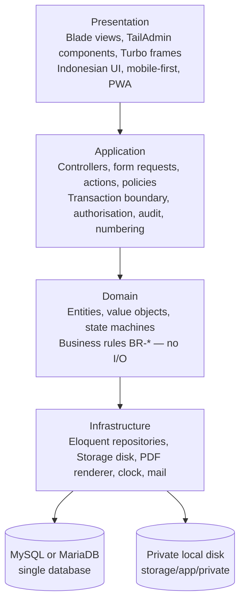
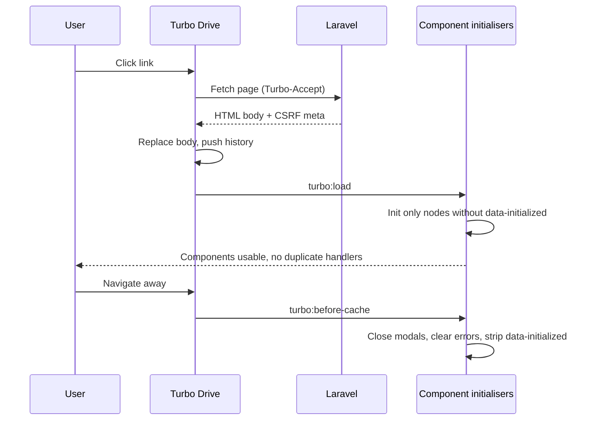
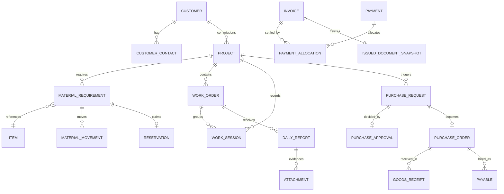

# Architecture — WJ-CCTV Business Operations System

| Field | Value |
|---|---|
| Status | Target baseline — no code exists |
| Version | 0.2 — baseline reconciled 2026-10-25 |
| Scope owner | System structure, module boundaries, platform baseline, deployment |
| Requirement source | [`../PRD.md`](../PRD.md) §2.4, §7 |
| Decision records | [`../decisions/`](../decisions/) — see ADR-008 for the stack |

---

## 1. Basis and honesty statement

**Current repository state (2026-10-25, measured):** Git metadata present, branch `main`, clean tree, remote `origin` → `https://github.com/tupski/WJC-BMS.git`. The client states the project is hosted at GitHub `tupski/WJC-BMS` — **[Confirmed] as a client statement**. No network access was available, so remote branch state and commit SHAs are **unverifiable offline** and are not asserted. Historical note: the first authoring pass ran against a workspace verified empty (no `.git`); accurate then, not current status.

There is **no application code, no installed dependency, no build or test command, and no configuration file.** Everything below is a **target** design. Nothing has been scaffolded, installed, benchmarked, or run.

**[Confirmed]** constraints shaping the design: ~3 office employees and ~15 technicians · operations spanning administration, purchasing, suppliers, project execution, field work, invoicing, and financial administration · spreadsheets and WhatsApp as the current tooling, with no centralised inventory · multi-day projects, teams from one technician to several, work in discrete sessions · the owner approves **every** purchase · an unconfirmed-cause invoice-numbering conflict.

These argue strongly against distributed systems. A team of this size cannot operate microservices, a message broker, or an event-sourced platform without dedicating a disproportionate share of its capacity to infrastructure.

---

## 2. Architectural style: modular monolith

**[Confirmed]** A single deployable Laravel application with **enforced module boundaries**, one relational database, and one private local filesystem.

| Consideration | Modular monolith | Microservices |
|---|---|---|
| Operational burden for ~3 office staff with no ops engineer | One deploy, one database, one log stream | Multiple deploys, service discovery, distributed tracing, network failure modes |
| Transactional integrity for numbering, reservations, approvals | Native ACID across all modules | Requires sagas/outbox; correctness becomes a distributed problem |
| Team size | Suitable | Requires more engineers than exist |
| Evolution path | Modules extractable later if a boundary proves independent | Extraction backwards is expensive |

The decisive argument is transactional integrity. The two highest-risk requirements — atomic number allocation (FR-DOC-004) and reservation correctness across projects (FR-MATL-006) — are trivially correct inside one transaction and materially harder across service boundaries. Choosing distribution here would create the exact class of bug the business is trying to eliminate.

**Consequence:** boundaries must be real, not nominal — enforced by module-private data access, cross-module reads through public interfaces, and an automated dependency check that fails on illegal imports (AC-OPS-016). Without enforcement, a modular monolith degrades into a monolith with folders.

### 2.1 Layers

**Rules:** dependencies point downward only, and the domain never imports infrastructure · a use case owns exactly one transaction (NFR-DATA-001) · authorisation is checked in the application layer before any write, and again at the data-access boundary for row-scoped entities · audit records are written inside the same transaction as the change (FR-AUD-003), the single most important structural rule · domain logic does not read the clock or generate identifiers directly — both are injected, so time-dependent rules are testable.

**Laravel migrations and database transactions are the implementation-facing abstraction.** Engine-specific SQL appears only where the schema builder cannot express the requirement (generated columns, functional indexes, atomic allocation), and only inside a transaction — see §4.

### 2.2 Module boundaries

| Module | Owns | Public interface | Depends on |
|---|---|---|---|
| `identity` | Users, roles, permissions, sessions | `can(user, action, resource)`, `currentUser()` | — |
| `audit` | Audit events, hash chain, queries | `record(event)`, `query(filter)` | `identity` |
| `numbering` | Series registry, counters, allocations, format rendering | `allocate(seriesKey, context)` | — |
| `customer` | Customers, contacts, service categories | `getCustomer(id)`, `listFor(user)` | `identity` |
| `catalog` | Item catalogue, units | `getItem(id)`, `search()` | — |
| `supplier` | Suppliers, terms | `getSupplier(id)` | `identity` |
| `project` | Projects, assignments, schedules, project state machine, work sessions | `createProject`, `transition`, `closeProject`, `startSession`, `endSession` | `customer`, `identity` |
| `workorder` | Work orders, daily reports, evidence, completion verification | `assign`, `submitReport`, `submitCompletion`, `verify` | `project`, `identity` |
| `material` | Requirements, stock status, reservations, ledger, issues/returns | `reserve`, `issue`, `consume`, `return`, `reconcile` | `project`, `catalog` |
| `procurement` | Purchase requests, approvals, POs, goods receipts | `submitRequest`, `approve`, `issuePo`, `receive` | `material`, `supplier`, `numbering` |
| `finance` | Quotations, invoices, payments, payables, expenses, allocations | `issueInvoice`, `recordPayment`, `confirm` | `project`, `customer`, `numbering` |
| `document` | File storage, attachments, PDF generation, document registry | `store`, `attach`, `render`, `download` | `identity` |
| `settings` | SMTP configuration, company profile, bank accounts | `mailConfig()`, `companyProfile()` | `identity`, `audit` |
| `reporting` | Read models and exports | `dailyProgress`, `projectDashboard`, `ageing` | read-only across modules |

**Boundary rules:** `material` and `procurement` never mutate each other's records; a goods receipt publishes a fact that `material` consumes to create an inbound movement, in one transaction · `finance` never reads `material` tables directly — it reads project cost through the `project` cost interface, which aggregates recognised sources (BR-FIN-005) · `settings` exposes configuration **values**, never the settings tables; SMTP credentials are decrypted only inside the mail transport · `reporting` is read-only and never the source of a business decision · `numbering` has no dependencies and must stay that way.

---

## 3. Platform baseline

**[Confirmed]** The stack is a client requirement, recorded in [`../decisions/ADR-008-laravel-platform-baseline.md`](../decisions/ADR-008-laravel-platform-baseline.md). Not a proposal awaiting ratification, and not installed.

| Layer | Baseline | Requirement |
|---|---|---|
| Framework | **Laravel 13.x**, latest stable patch; minimum **13.29.0** | NFR-PLAT-001, NFR-PLAT-008 |
| View | **Blade**, server-rendered | NFR-PLAT-002 |
| Navigation / progressive updates | **Hotwire Turbo** (Drive, Frames, Streams) | NFR-PLAT-002, NFR-OPS-011 |
| UI foundation | **TailAdmin Free Laravel**, gated | NFR-PLAT-003 |
| Database | **MySQL 8.0.16+ / MariaDB 10.2.1+** | NFR-PLAT-004, NFR-DATA-009 |
| Storage | **Private local disk** outside the webroot, S3-migratable | FR-DOC-001, FR-DOC-009 |
| Locale | `id` default; `Asia/Jakarta`; IDR | NFR-PLAT-005 |
| Delivery | Responsive mobile-first web with PWA support | NFR-PLAT-006 |
| Structure | Modular monolith | NFR-PLAT-007 |

**Explicitly rejected:** microservices, event sourcing as the system of record, CQRS with separate stores, message brokers, Kubernetes, GraphQL, client-side document numbering, a JavaScript SPA framework, and — as a hard prohibition — **downgrading Laravel below 13.x to accommodate a template**.

### 3.1 TailAdmin compatibility gate

TailAdmin cannot be audited here (no network). Its release, licence, dependency set, and Laravel constraint are **[Open Question] Q-UI-01**, and use is conditional on a **Phase 1 entry gate** with a written exit criterion (AC-OPS-015).

| Verification item | Must be recorded in writing |
|---|---|
| Exact package and repository | Named source, not a blog link |
| Release tag / version | Exact identifier |
| Licence terms | Including attribution requirements |
| Declared `laravel/framework` constraint | From its own manifest, not assumed |
| Tailwind and Vite versions | Compatibility with our build |
| Published Laravel 13 support | Yes / no / unknown |

**Minimum adaptation path if no Laravel 13-compatible release exists.** Treat TailAdmin as a **view layer only**: copy its Blade components, layouts, and Tailwind assets into the application; discard its service providers, routes, middleware, and auth scaffolding; keep our own auth, policies, and routing; pin `laravel/framework` per our baseline. Risks accepted explicitly: divergent Tailwind configuration, inherited Alpine/jQuery initialisation assumptions that conflict with Turbo (§3.2), upgrade friction when the template changes, and licence attribution obligations.

**Forbidden responses:** silently downgrading Laravel, substituting Filament or another admin panel, or adopting a paid TailAdmin edition.

### 3.2 Hotwire Turbo × TailAdmin: the lifecycle problem

Turbo Drive intercepts navigation and replaces the `<body>` **without a full page load**. TailAdmin's JavaScript — dropdowns, modals, sidebar toggles, table widgets — binds on `DOMContentLoaded`, which fires **once**.

| Symptom | Cause |
|---|---|
| Dropdowns and modals stop working after the first navigation | Initialisers never re-run |
| A component works twice after naive re-running | Duplicate listeners on the same node |
| A modal appears already open | Cached DOM snapshot restored with stale classes |
| Validation errors vanish | Turbo replaced the body and the error markup was not in the response |
| CSRF failures after restore | Token stale in a restored cached page |

**Required pattern:**

1. **Initialise on `turbo:load` and `turbo:frame-load`**, never `DOMContentLoaded` alone (which may run one initial pass for a hard load).
2. **Idempotent initialisation** — mark initialised nodes (`data-initialized="true"`), skip on repeat, tear down explicitly on `turbo:before-cache`.
3. **Never bind anonymous handlers that survive cache restoration.** Use event delegation on `document` for global behaviours.
4. **Reset transient UI state on `turbo:before-cache`**: close modals and dropdowns, clear inline errors, remove `data-initialized`, drop open-menu classes.
5. **File uploads** — re-initialise preview and progress widgets on `turbo:load`; use `data-turbo="false"` or `turbo-stream` for flows that must not navigate away; refresh the CSRF token after restoration, since a stale token produces a 419 that looks like a random failure.
6. **Form validation** must return **HTTP 422 with a re-rendered form** carrying the error bag and old input — not a redirect-with-flash-only, which loses the errors and teaches users that saving "sometimes does nothing".

**Acceptance criteria:** navigate away and back with components working (AC-OPS-009); no duplicate submit handlers after five navigations (AC-OPS-010); modal open/close survives navigation (AC-OPS-011); upload control re-initialises (AC-OPS-012).

---

## 4. Data integrity and transaction boundaries

| Concern | Mechanism |
|---|---|
| Document number uniqueness | Single-row atomic allocation on a counter row plus `UNIQUE (series_key, document_number)` (ADR-009) |
| Reservation correctness | Conditional single-row `UPDATE` on the item balance, or `SELECT … FOR UPDATE` by primary key; reservation insert and balance change commit together |
| Approval → PO | Approval row and PO creation in one transaction; a constraint plus state guard refuse a PO whose request is not `APPROVED` (FR-PROC-011) |
| Goods receipt → stock | Receipt lines and inbound movements written atomically; a posted receipt without movements is impossible |
| Invoice issuance | Number allocation, snapshot write, PDF record, and audit row in one transaction |
| Payment allocation | Allocation sum ≤ invoice total checked under lock; overpayment becomes an unapplied credit |
| Audit coupling | Audit insert in the same transaction; a trigger on high-risk tables asserts the audit row exists |
| Issued document immutability | Snapshot tables insert-only; `UPDATE`/`DELETE` revoked from the application database user |
| Case-insensitive uniqueness | `*_normalized` column with a unique index (chosen over `_ci` collation — DATA_MODEL §1.2) |
| Soft-delete-aware uniqueness | Generated column that is `NULL` when soft-deleted; unique indexes ignore `NULL` |
| Engine version floor | `CHECK` requires MySQL 8.0.16+ / MariaDB 10.2.1+; earlier versions parse and ignore it (NFR-DATA-009) |

**Engine-specific notes.** No `RETURNING` on `UPDATE` — allocation uses `LAST_INSERT_ID()` inside the issuing transaction (DOCUMENT_NUMBERING §5). No partial unique indexes — generated columns instead (DATA_MODEL §1.3). No deferrable FKs — order inserts correctly and avoid circular FKs with a nullable FK plus application sequencing. DDL is non-transactional, so migrations follow expand → migrate → contract (NFR-DATA-010). MySQL defaults to `REPEATABLE READ` with gap locks; allocation and reservation paths use `READ COMMITTED` or a single-row atomic `UPDATE`, and deadlocks are retried under a bounded policy (DATA_MODEL §1.4).

**Concurrency policy:** the system is small but concurrent — three office staff issuing invoices simultaneously is exactly the scenario that produced the historical conflict. Allocation and balance-mutating operations must be proven under parallel load (AC-DATA-002, AC-MATL-006), not merely tested sequentially.

---

## 5. Key relationship shapes

Three shapes carry most of the business correctness:

1. **`material_movements` is the only way quantity changes.** No writable `quantity` column a user can edit; balance is derived, with a reconciled materialised value for performance (FR-MATL-012/013).
2. **`issued_documents` + snapshot is written once and never updated.** Every issued document renders from its snapshot, never live master data (FR-FIN-003, BR-DOC-001, BR-SYS-001).
3. **`work_sessions` is independent of project and work-order status.** Many sessions per project, many per technician, each with immutable server timestamps (FR-TECH-011/012).

---

## 6. Private file storage (local-first)

Files are written to a **dedicated private disk outside the webroot** — e.g. `storage/app/private` — through the `Storage` facade. No public URL, no `public_path()` in business logic, no hard-coded absolute paths (FR-DOC-001). Every read goes through a route that authorises against the owning record and then **streams** the response with the correct `Content-Type` and `Content-Disposition`; directory listing is impossible because the directory is not served (NFR-SEC-010).

Keys are opaque and non-guessable, never encoding customer names or invoice numbers. Every attachment records owning entity, uploader, timestamp, **disk name, relative path**, content type, byte size, and SHA-256 — never an absolute URL (DATA_MODEL §8).

Uploads are validated server-side: MIME sniffing (never extension trust), size limit, image dimension limit, filename sanitisation, path-traversal prevention (FR-TECH-005). Issued PDFs and snapshots are immutable, and deletion of a file referenced by an issued document is prohibited.

**S3 migration path.** One disk abstraction; `Storage::temporaryUrl()` where the driver supports it; no local-path assumptions in Blade. Moving to S3 later is a configuration change plus a verified migration procedure — **not** a module rewrite (FR-DOC-009). **Backup** covers the database **and** this directory; a restore that recovers rows but not files is an incomplete restore (NFR-DATA-004/005).

---

## 7. Audit architecture

Append-only table; `UPDATE`/`DELETE` revoked from the application database user. MySQL/MariaDB has no rule system with security-definer parity, so the enforcement stack is **restricted grants + triggers on high-risk tables + application-layer immutability** — limits stated in AUDIT_LOGGING §5.

Written in the same transaction as the state change (FR-AUD-003); there is no asynchronous path, because a crash between commit and audit write creates an unattributable change. Each record captures actor, effective roles at the time, action, entity, before/after for changed fields, timestamp, correlation ID, and source IP. Hash chaining over issued-document, approval, and configuration events provides tamper evidence (NFR-AUD-003). Audit writes never contain secrets, password hashes, SMTP credentials, or file contents.

---

## 8. Deployment and environments

**[Proposed]**

| Environment | Purpose | Data |
|---|---|---|
| Development | Local work | Synthetic fixtures only |
| Staging | Pre-release verification, UAT, migration rehearsal | Anonymised copy or synthetic; never live personal data |
| Production | Live business operations | Real data, access-restricted |

Single-region deployment close to Indonesia for technician latency (NFR-OPS-004) · production database not reachable from the public internet · a queue worker for mail and PDF generation · migrations as an explicit release step, forward-only, rehearsed on staging (NFR-DATA-006), with no automatic destructive migration on deploy (NFR-DATA-010) · configuration via environment variables, secrets never in the repository (NFR-SEC-007) · rollback by redeploying the previous artefact, with database changes backward-compatible for at least one release.

### 8.1 Runtime configuration vs `config:cache`

Settings edited in the UI (SMTP, company profile, numbering) must not be silently ignored because a cached configuration file is stale. **Chosen approach:** persistent settings live in the database and are read through a **runtime settings resolver** (an in-memory cache with explicit invalidation on write), **not** baked into `config/*.php`. Framework-level values that genuinely come from the environment still require `config:cache` to be rebuilt on change — documented as a deployment step, not left to chance. Queue workers read the resolver at job start, so a settings change takes effect without a worker restart. Writing to `.env` and rebuilding the cache is rejected as fragile and unauditable.

**[Open Question] Q-OPS-01** — hosting, backup location, retention, and access policy remain unconfirmed. Defaults in the PRD keep planning unblocked.

---

## 9. Migration and maintenance

Migration is a **product feature**, not a one-off script (FR-DATA-001…006): validation dry-run, explicit commit, per-row rejection report, verbatim preservation of historical numbers. Imported historical numbers are flagged so they neither advance the counter nor collide (FR-DATA-004).

Operational tasks: daily reconciliation report (FR-MATL-013), audit chain verification, backup verification covering files, overdue ageing refresh, orphaned-file scan, service-worker cache version review. All must be idempotent and safe to re-run.

---

## 10. What this architecture deliberately does not do

| Not done | Reason |
|---|---|
| Microservices | No operational capacity; would break transactional guarantees the highest-risk requirements depend on |
| Event sourcing as system of record | The audit log already provides history; adds reconstruction complexity for no business gain |
| Full warehouse model (bins, lots, serials) | Project-scoped control suffices (Q-INV-01 defines the expansion trigger) |
| General ledger | Requires accountant input; L3 is out of MVP scope (Q-FIN-01) |
| Native mobile app | Mobile-first PWA covers the need (Q-UX-01) |
| Offline-first synchronisation | Not a requirement; MVP is online-first with local draft preservation only (NFR-OPS-010) |
| In-app routing engine | OSM tiles carry no routing; directions deep-link to Google Maps (FR-MAP-002) |
| Client-side document numbering | Directly contradicts FR-DOC-004 and the confirmed failure mode |
| Laravel downgrade for template compatibility | Explicitly forbidden (NFR-PLAT-001) |

---

## 11. Cross-references

- Requirements and status vocabulary: [`../PRD.md`](../PRD.md)
- Entities and engine-specific types: [`./DATA_MODEL.md`](./DATA_MODEL.md)
- Permissions and overrides: [`./SECURITY_AND_ACCESS_CONTROL.md`](./SECURITY_AND_ACCESS_CONTROL.md)
- Numbering mechanism: [`../standards/DOCUMENT_NUMBERING.md`](../standards/DOCUMENT_NUMBERING.md)
- Audit model: [`../standards/AUDIT_LOGGING.md`](../standards/AUDIT_LOGGING.md)
- Phasing: [`../implementation/IMPLEMENTATION_PLAN.md`](../implementation/IMPLEMENTATION_PLAN.md)
- Stack decision: [`../decisions/ADR-008-laravel-platform-baseline.md`](../decisions/ADR-008-laravel-platform-baseline.md)
