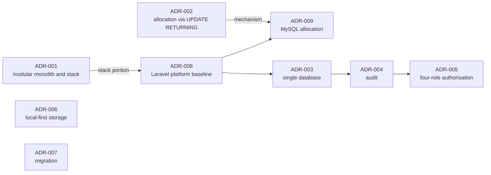

# Architecture Decision Records

One decision per record. Each states its context, decision, consequences, alternatives considered, status, and verification obligations.

**No decision has been implemented.** There is no application code in this repository. Two records were superseded on 2026-10-25 when the client revised the platform baseline; their bodies are retained as history.

## Index

| ADR | Title | Decision in one line | Status |
|---|---|---|---|
| [ADR-001](./ADR-001-modular-monolith-and-stack.md) | Modular monolith architecture and technology stack | One deployable application with enforced module boundaries — **style accepted; stack superseded** | **Superseded by ADR-008** |
| [ADR-002](./ADR-002-document-number-allocation.md) | Document number allocation strategy | Atomic allocation on a counter table inside the issuing transaction — **reasoning retained, SQL superseded** | **Superseded by ADR-009** |
| [ADR-003](./ADR-003-single-relational-database.md) | Single relational database with immutable snapshots | One database; issued documents render from frozen snapshots; soft-deactivate master data — **amended for MySQL/MariaDB** | Accepted (Rev 2) |
| [ADR-004](./ADR-004-audit-logging-approach.md) | Audit logging approach | Same-transaction append-only audit, privilege- and trigger-enforced, hash-chained — **amended for engine limits** | Accepted (Rev 2) |
| [ADR-005](./ADR-005-authorisation-model.md) | Authorisation model | Action-and-resource permissions, four roles, structural technician scoping, logged overrides — **rewritten for four roles** | Accepted (Rev 2) |
| [ADR-006](./ADR-006-private-file-storage.md) | Private file storage | Private local disk outside the webroot, authorised streamed downloads, S3 migration path — **S3-first superseded** | Accepted (Rev 2) |
| [ADR-007](./ADR-007-spreadsheet-migration.md) | Spreadsheet migration approach | Migrate master data and open items; preserve historical numbers verbatim; freeze spreadsheets at cutover | Accepted (verified, no change) |
| [ADR-008](./ADR-008-laravel-platform-baseline.md) | Laravel 13 platform baseline | Laravel 13 + Blade + Turbo + TailAdmin (gated) + MySQL/MariaDB + PWA; TailAdmin compatibility and CVE verification are conditions | **Accepted — client-mandated** |
| [ADR-009](./ADR-009-mysql-document-number-allocation.md) | Atomic allocation on MySQL/MariaDB | `UPDATE … LAST_INSERT_ID(next_value + step)` then `SELECT LAST_INSERT_ID()`, inside the issuing transaction | Accepted (design) |

## Reading order

For a new contributor: **ADR-008 → ADR-003 → ADR-009 → ADR-004 → ADR-005 → ADR-006 → ADR-007**, then ADR-001 and ADR-002 as history.

ADR-008 comes first because it defines the platform everything else must work on. ADR-009 is placed early despite its narrow subject because document numbering is the highest-severity known defect and constrains several later decisions.

## Supersession map

## How these records relate to other documents

| ADR | Elaborated by |
|---|---|
| ADR-001 | [`../architecture/ARCHITECTURE.md`](../architecture/ARCHITECTURE.md) §2 (style only) |
| ADR-002 | [`../standards/DOCUMENT_NUMBERING.md`](../standards/DOCUMENT_NUMBERING.md) (history) |
| ADR-003 | [`../architecture/DATA_MODEL.md`](../architecture/DATA_MODEL.md) |
| ADR-004 | [`../standards/AUDIT_LOGGING.md`](../standards/AUDIT_LOGGING.md) |
| ADR-005 | [`../architecture/SECURITY_AND_ACCESS_CONTROL.md`](../architecture/SECURITY_AND_ACCESS_CONTROL.md) |
| ADR-006 | [`../architecture/ARCHITECTURE.md`](../architecture/ARCHITECTURE.md) §7 |
| ADR-007 | [`../PRD.md`](../PRD.md) §6.8 |
| ADR-008 | [`../architecture/ARCHITECTURE.md`](../architecture/ARCHITECTURE.md) §3 |
| ADR-009 | [`../standards/DOCUMENT_NUMBERING.md`](../standards/DOCUMENT_NUMBERING.md) §5 |

An ADR states the decision and its rationale. The linked document states the operational detail. Where they appear to conflict, the ADR governs the decision and the document governs the procedure — a conflict should be raised rather than silently resolved.

## Status values

| Status | Meaning |
|---|---|
| Proposed | Recommended, awaiting ratification. Must not be cited as settled |
| Accepted | Ratified. For a client-mandated baseline, "accepted" means the client required it |
| Amended | Decision unchanged; mechanism or detail revised in place, with a revision note |
| Superseded | Replaced by a later ADR, which is named. The body is retained as history |
| Rejected | Considered and declined, with the reason recorded |

## What no ADR in this set claims

- That any decision is implemented, installed, or running.
- That a build, test, dependency audit, or security scan was performed.
- That the client-cited CVE and its fix version are verified — that is **Q-SEC-01**, an open question with a mandatory release gate.
- That TailAdmin's compatibility or licence is established — that is **Q-UI-01**, a Phase 1 entry gate.

## Adding a decision

A new ADR is warranted when a choice is **architecturally significant** — it constrains future work, is expensive to reverse, or affects a cross-cutting property such as security, data integrity, or auditability.

Not warranted for: naming conventions, minor library choices, or anything reversible in an afternoon.

Each ADR must state alternatives considered and why they were rejected. A decision record that lists no alternatives is a decision that was not examined.

**When superseding:** create the new record, set the old record's status to `Superseded by ADR-NNN`, keep the old body intact, add a supersession note at the top explaining precisely which part was replaced and which part survives. Do not delete history — the reasoning is often the most valuable part.
