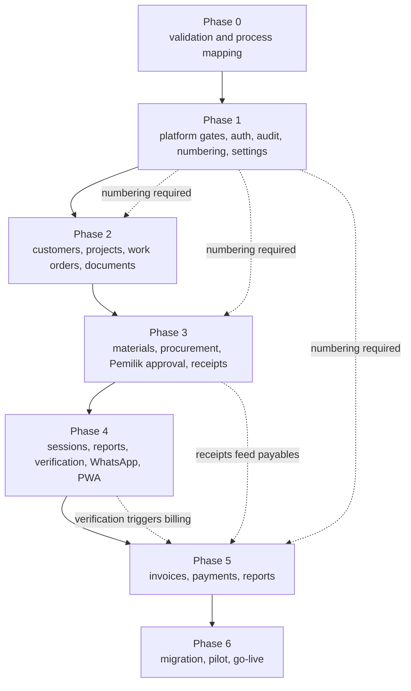

# Implementation Plan — WJ-CCTV Business Operations System

| Field | Value |
|---|---|
| Status | Target plan — planning only, no implementation has begun |
| Version | 0.2 — platform gates added 2026-10-25 |
| Scope owner | Phasing, sequencing, prerequisites, deliverables, risks, exit criteria |
| Requirement source | [`../PRD.md`](../PRD.md) |
| Repository basis | Documentation only: no code, no installed stack, no build or test commands |

---

## 1. Sequencing principle

Phases are ordered by **dependency**, not visible business value. Three foundations precede anything touching money:

| Foundation | Must precede | Why |
|---|---|---|
| **Audit logging** | Every approval, issuance, payment, override | Retrofitting audit means auditing code paths nobody remembers writing, with gaps that can never be filled |
| **Document numbering** | Any quotation, PO, or invoice issuance | Issuing documents before the mechanism exists repeats the original defect |
| **Platform baseline + authorisation** | Every screen and endpoint | Screens built before the permission model exist are written without a policy check |

**[Confirmed]** the numbering conflict is the highest-severity known defect, so it is addressed in Phase 1, not Phase 5 — the *mechanism* ships early, the *invoice screens* later.

---

## 2. Phase overview

| Phase | Theme | Key outcome | Requirement blocks |
|---|---|---|---|
| 0 | Requirements validation and process mapping | Confirmed answers, profiled data, agreed scope | — (enables all) |
| 1 | Platform baseline, auth, roles, master data, audit, numbering, settings | Secure, audited, numbered, configurable platform | NFR-PLAT-*, NFR-SEC-*, FR-AUD-*, FR-DOC-004/006, FR-SYS-001…004 |
| 2 | Customers, quotations, projects, work orders, documents | Projects exist and are managed | FR-CUST-003…006, FR-PROJ-001…008/011…013, FR-FIN-001, FR-DOC-001…003/005/007/009 |
| 3 | Materials, procurement, **Pemilik approval**, goods receipt | Materials controlled end to end | FR-MATL-001…007/012/014, FR-PROC-001…012 |
| 4 | Technician operations, **work sessions**, verification, WhatsApp, PWA | Field operations captured with real timestamps | FR-TECH-001…014, FR-MATL-008…011/013, FR-PROJ-009/010, FR-WA-*, FR-PWA-*, FR-MAP-* |
| 5 | Invoices, payments, payables, expenses, reports | Money tracked and chased | FR-FIN-002…012, FR-RPT-001…008 |
| 6 | Pilot, migration, UAT, go-live | Business running on the system | FR-DATA-001…006 |
| 7+ | Later phases | Centralised stock, profitability, accounting, offline sync | Deferred (§10) |

---

## 3. Phase 0 — Requirements validation and process mapping

**Purpose:** convert assumptions into facts before building. This phase produces no software; skipping it is the most common cause of a system that fits the spec but not the business.

| # | Activity | Output |
|---|---|---|
| 0.1 | Walk through the current process with owner and office staff | Process map of actual (not assumed) workflow |
| 0.2–0.3 | Collect and profile every spreadsheet, Word template, and WhatsApp report format | Data inventory; data-quality report (Q-DATA-01) |
| 0.4 | Confirm client invoice-numbering constraints in writing | Answers to Q-NUM-01 (nine questions) |
| 0.5 | Confirm the purchasing approval rule in practice | Confirms BR-PROC-005 (Q-PROC-01 already resolved) |
| 0.6 | Confirm supplier delivery and goods-receipt practice | Q-PROC-02 |
| 0.7 | Confirm the technician reporting model and team-leader usefulness | Q-ROLE-01 |
| 0.8 | Consult the accountant on tax and statutory needs | Q-FIN-01, Q-FIN-02, Q-FIN-03 |
| 0.9–0.10 | Confirm hosting, backup, retention; company contact fields and bank accounts | Q-OPS-01, Q-SYS-01 |
| 0.11 | Confirm WhatsApp destination model and email notification needs | Q-WA-01, Q-MAIL-02 |
| 0.12 | Measure baseline metrics | Q-BASE-01 |
| 0.13 | Validate mobile device and network reality with 2–3 technicians | A-01, Q-UX-01 input |
| 0.14 | **Confirm numbering reset scope and step semantics** | Q-NUM-06, Q-NUM-07, Q-NUM-08 |
| 0.15 | **Verify the CVE claim and the TailAdmin release** | Q-SEC-01, Q-UI-01 (may defer to Phase 1 entry) |

**Deliverables:** current-state process map · data inventory and profiling report · answered open-questions register · confirmed MVP scope (signed off) · baseline metrics for M1–M12.

**Risks:** process mapping reveals the business differs from the brief (re-baseline scope now — the cheapest possible moment) · spreadsheets unusable for migration (scope manual re-entry) · owner unavailable for decisions (fixed decision sessions, documented in writing).

**Exit criteria**

- [ ] All nine Q-NUM-01 questions answered in writing
- [ ] Q-NUM-06/07/08, Q-PROC-02, Q-ROLE-01, Q-FIN-01/02/03, Q-OPS-01, Q-SYS-01, Q-WA-01 answered or explicitly deferred with a default accepted
- [ ] Spreadsheet profiling complete with a documented mapping specification
- [ ] MVP scope signed off by the owner
- [ ] Baseline metrics recorded or measurement method agreed
- [ ] At least one technician confirms the device/network assumption

---

## 4. Phase 1 — Foundations

**Purpose:** build the platform every later phase depends on. No business workflow ships here, and that is intentional.

### 4.0 Entry gates (blocking — before any UI or feature work)

#### Gate 1 — Platform compatibility and licence (Q-UI-01)

| # | Check | Evidence |
|---|---|---|
| 1 | Exact TailAdmin Free Laravel package and repository identified | Named source |
| 2 | Release tag recorded | Exact version |
| 3 | Licence terms recorded, **including attribution requirements** | Quoted terms |
| 4 | Declared `laravel/framework` constraint read from its own manifest | Constraint string |
| 5 | Tailwind and Vite versions recorded | Version numbers |
| 6 | Laravel 13 support confirmed, or the view-layer adaptation path chosen | Written decision |

**Exit criterion:** a **written compatibility and licence sign-off** naming the chosen path — "use TailAdmin as supplied" or "vendor as view layer only".

**Forbidden:** downgrading Laravel below 13, substituting Filament, adopting a paid TailAdmin edition.

#### Gate 2 — Security version verification (Q-SEC-01)

| # | Check | Evidence |
|---|---|---|
| 1 | `composer audit` run against the resolved dependency set | Output archived |
| 2 | Resolved `laravel/framework` version recorded | Exact version |
| 3 | Version compared against the official advisory for the client-cited CVE | Advisory reference and finding |
| 4 | Confirmation that the resolved version is ≥ 13.29.0 | Comparison recorded |

**Exit criterion:** the resolved version satisfies the client's floor **and** the advisory finding is recorded. If the advisory cannot be located or contradicts the claim, the discrepancy is escalated — not silently resolved.

### Deliverables

| # | Deliverable | Requirement IDs |
|---|---|---|
| 1.1 | Laravel 13.x skeleton, environments, deployment pipeline | NFR-OPS-001, NFR-PLAT-001 |
| 1.2 | Blade layout, TailAdmin per Gate 1, Turbo wiring, idempotent initialisation | NFR-PLAT-002/003, NFR-OPS-011 |
| 1.3 | Locale `id`, timezone `Asia/Jakarta`, UTC storage convention | NFR-OPS-009, NFR-PLAT-005 |
| 1.4 | Schema baseline on MySQL/MariaDB, version assertion, forward-only policy | NFR-DATA-006/009/010, NFR-PLAT-004 |
| 1.5 | Authentication: hashing, sessions, idle expiry, lockout | NFR-SEC-001/004/005 |
| 1.6 | Authorisation: four roles, permissions, multi-role, policy checks | NFR-SEC-002/003 |
| 1.7 | Audit logging: append-only table, grants, triggers, coupling, hash chain | FR-AUD-001…003, NFR-AUD-001…003 |
| 1.8 | Numbering: series registry, configurable template, atomic allocation | FR-DOC-004/006, FR-SYS-004, NFR-DATA-002 |
| 1.9 | Override mechanism with reason capture and `PEMILIK` report | FR-AUD-004, NFR-AUD-004 |
| 1.10 | Private storage disk, upload validation, streamed downloads | FR-DOC-001/009, NFR-SEC-010 |
| 1.11 | SMTP module: encrypted credential, masked field, tests, runtime resolver | FR-SYS-001/002, NFR-SEC-009 |
| 1.12 | Company profile and bank accounts, logo validation | FR-SYS-003 |
| 1.13 | Customer, supplier, item, service-category, and technician masters | FR-CUST-001/002, FR-PROC-004, FR-MATL-001, FR-PROJ-002, FR-TECH-001 |
| 1.14 | PWA shell: manifest, icons, static-only service worker | FR-PWA-001…003 |
| 1.15 | Backup automation for database **and** files, plus first rehearsal | NFR-DATA-004/005 |

### Risks

| Risk | Impact | Mitigation |
|---|---|---|
| Numbering implemented with a subtle race | Repeats the original defect | Concurrency tests written **with** the feature (AC-DATA-002) |
| Audit coupling forgotten on some paths | Unattributable changes | Triggers on high-risk tables; per-transition audit test |
| TailAdmin incompatible and pressure to downgrade Laravel | Baseline violation | Gate 1 with a written decision; NFR-PLAT-001 forbids downgrade |
| Turbo re-initialisation bugs | Silent UI breakage | Idempotent pattern plus navigation tests (AC-OPS-009…012) |
| Over-engineering the permission model | Delay with no business value | Permission codes tied to actual §6 requirements |
| Phase feels like "no progress" | Pressure to skip ahead | Demonstrate numbering and audit working via tests |

### Exit criteria

- [ ] **Gate 1 signed off** (compatibility + licence)
- [ ] **Gate 2 signed off** (resolved version ≥ 13.29.0 and advisory recorded)
- [ ] N concurrent issuance tests produce N distinct numbers, zero violations (M1)
- [ ] Direct DB duplicate insert rejected by constraint
- [ ] Audit `UPDATE`/`DELETE` fail for the application user **and** the trigger
- [ ] A failed state change leaves no audit record and no state change
- [ ] Multi-role permission union verified
- [ ] Technician account receives 403 on finance and settings endpoints
- [ ] Format, padding, starting value, and step configurable without code change
- [ ] SMTP credential never appears in any response, page source, or log
- [ ] Company profile change does not alter an already-issued PDF
- [ ] Navigate away and back: components work; no duplicate handlers after 5 navigations
- [ ] Service worker caches no authenticated response
- [ ] Restore rehearsal completed for database **and** files, with recorded duration

---

## 5. Phase 2 — Customers, quotations, projects, work orders, documents

| # | Deliverable | Requirement IDs |
|---|---|---|
| 2.1 | Service categories, duplicate warning, customer 360 view | FR-CUST-003/005/006 |
| 2.2 | Customer PO reference capture | FR-CUST-004 |
| 2.3 | Quotation creation and issuance (numbered, PDF) | FR-FIN-001 |
| 2.4 | Project creation with optional links; site address and optional coordinates | FR-PROJ-001…004, FR-PROJ-013 |
| 2.5 | Schedule, revisions, multi-day support | FR-PROJ-005/006 |
| 2.6 | Assignment: one-to-many technicians, single team-leader designation | FR-PROJ-007, FR-TECH-002 |
| 2.7 | Budget fields and cost display placeholder | FR-PROJ-008 |
| 2.8 | Project state machine with guarded transitions | FR-PROJ-011/012 |
| 2.9 | Work-order creation and assignment | FR-TECH-003 |
| 2.10 | PDF generation with company snapshot, immutable storage | FR-DOC-002/003/008, FR-SYS-003 |
| 2.11 | Attachment upload, private storage, authorised streamed download | FR-DOC-001/007, NFR-SEC-010 |
| 2.12 | Document retrieval by number with history | FR-DOC-005 |
| 2.13 | Map display with graceful placeholder; directions deep link | FR-MAP-001/002 |

**Risks:** forcing optional steps into the UI (AC-PROJ-001) · state machine leaks (centralised transition function; test every illegal transition) · PDF coupled to live data (snapshot-first rendering; test M4) · map treated as mandatory (AC-MAP-001).

**Exit criteria:** minimal project creatable and schedulable · non-CCTV category needs no CCTV field · project without coordinates works with a placeholder · every illegal transition refused with options named · schedule revision preserves previous values · one team leader maximum (constraint verified) · quotation issued with number and PDF, byte-identical after a customer rename · issued PDF unchanged after a company bank-detail change.

---

## 6. Phase 3 — Materials, procurement, approval, goods receipt

| # | Deliverable | Requirement IDs |
|---|---|---|
| 3.1–3.3 | Requirement lines with `UNKNOWN` default; verification and history; coverage and shortfall | FR-MATL-001/002/003/007 |
| 3.4–3.6 | Reservation lifecycle; refusal on unverified lines; append-only ledger | FR-MATL-004/005/006/012 |
| 3.7 | Purchase request submission → `PENDING_APPROVAL` | FR-PROC-001 |
| 3.8 | **Pemilik approval workflow with server-side and database enforcement** | FR-PROC-002/011, BR-PROC-005 |
| 3.9 | Draft PO preparation blocked from issuance until approval | FR-PROC-012 |
| 3.10 | PO creation, issuance, snapshot, PDF | FR-PROC-005/006 |
| 3.11 | Goods receipt with partial delivery and discrepancies | FR-PROC-007/008 |
| 3.12 | Technician additional material request on own project | FR-MATL-014 |
| 3.13–3.14 | Readiness derivation; procurement pipeline report including `PENDING_APPROVAL` | PRD §9.3, FR-RPT-005 |

**Risks:** reservation race across projects (atomic conditional update + concurrency test) · PO treated as stock increase (explicit AC-PROC-005 test) · approval implemented as a hidden button (state guard **and** DB constraint; direct-HTTP test) · verification skipped under time pressure (hard refusal, not a warning) · partial receipt edge cases (`CHECK` constraints; multi-delivery test).

**Exit criteria:** new line is `UNKNOWN` and unreservable · two concurrent reservations for the last units: exactly one succeeds · PO issuance leaves available stock unchanged · three partial receipts accumulate exactly · over-receipt refused without approval · **a PO cannot be issued for a request that is not `APPROVED`, by any route** · **a direct HTTP request on an unapproved request errors with no side effects: no number, no snapshot, no PDF** · **`ADMIN` and `SUPER_ADMIN` cannot approve; only `PEMILIK` can** · a technician can raise an additional request on their own project only · no API or UI path allows direct quantity editing · the pipeline report reflects every state.

---

## 7. Phase 4 — Technician operations, sessions, verification, WhatsApp, PWA

| # | Deliverable | Requirement IDs |
|---|---|---|
| 4.1 | Mobile-first daily report form (360 px, < 3 min) | FR-TECH-004, NFR-OPS-003 |
| 4.2–4.3 | **Work session start/end with server timestamps; correction flow with reason and audit** | FR-TECH-011/012, BR-TECH-004 |
| 4.4 | **Completion submission and Admin verification flow** | FR-TECH-013, BR-TECH-005 |
| 4.5–4.6 | Photo/file evidence with server-side limits; issue, consumption, return, write-off | FR-TECH-005, FR-MATL-008…011 |
| 4.7–4.8 | Blocker recording, office surfacing, forgotten-session detection; reschedule/reassign with open-session guard | FR-TECH-006/007 |
| 4.9–4.10 | Assignment-scoped access enforcement; progress estimate display | FR-TECH-009/010, NFR-SEC-006 |
| 4.11–4.12 | Reconciliation checkpoint per project; closure with active-session check | FR-MATL-013, FR-PROJ-009/010 |
| 4.13 | Daily progress, workload, and session-hours reports | FR-RPT-001/006 |
| 4.14 | **WhatsApp report preparation with manual send and copy fallback** | FR-WA-001…003 |
| 4.15–4.16 | **Local draft preservation**; PWA update prompt and cache versioning | FR-PWA-003/004 |

**Risks:** report form too slow → WhatsApp continues (timed usability test; iterate) · session start/end treated as optional (one-tap start/end; forgotten-session list; correction flow rather than silent gaps) · photo failure loses the report (submit text independently; local draft) · technician sees another's data (structural scoping; negative tests) · verification backlog (queue as a primary office view) · offline expectation set too high (MVP states online-first explicitly).

**Exit criteria:** median report submission < 3 minutes at 360 px (M3) · report survives a simulated connection drop, and the draft is clearly not a submitted record · photo failure does not block submission · **2 technicians over 3 days records 6 sessions; a project-level single start/end is not possible** · **a technician cannot backdate or overwrite a session timestamp by any route** · **a correction requires a reason and preserves the original timestamps** · **ending a session does not complete the work order or project** · **verification yields `VERIFIED` or `RETURNED_FOR_CORRECTION`, the latter requiring a reason, both audited** · a technician cannot reach another's assignment (direct request) · issue/consume/return arithmetic cannot exceed issued · closure refused with unmet conditions including an active session · WhatsApp text carries no financial data, the URL is encoded, prepared ≠ sent, copy fallback works · the service worker caches no authenticated response.

---

## 8. Phase 5 — Finance

| # | Deliverable | Requirement IDs |
|---|---|---|
| 5.1 | Invoice creation, issuance, snapshot including company and bank details, PDF | FR-FIN-002/003 |
| 5.2–5.3 | Customer payments with allocation and partial payment; outstanding and ageing | FR-FIN-004/005/008 |
| 5.4–5.5 | Supplier payables and payment recording; confirmation as a separate action | FR-PROC-009/010, FR-FIN-009 |
| 5.6–5.7 | Operational and project expenses; cost accumulation without double counting | FR-FIN-006/007 |
| 5.8 | Void, credit note, replacement procedures | FR-FIN-011/012 |
| 5.9–5.10 | AR/AP reports and project dashboard; export and reproducibility | FR-FIN-010, FR-RPT-002/004/007/008 |
| 5.11 | **Configurable invoice numbering template validated against client requirements** | FR-SYS-004, Q-NUM-01 |

**Risks:** invoice issued before numbering is proven (proven in Phase 1; re-run at Phase 5) · double-counted cost (unique source constraint; composition report) · payment recorded but never confirmed (separate queue; unconfirmed report) · client rejects the format (Q-NUM-01 answered in Phase 0; per-client configuration) · configuration changed mid-year (audited, non-retroactive, refused if collision possible).

**Exit criteria**

- [ ] Invoice issuance under concurrency produces unique numbers (re-run M1)
- [ ] Issued invoice unchanged after customer, item, **and company** master edits (M4)
- [ ] Partial payments produce accurate outstanding balances
- [ ] Allocation cannot exceed balance; overpayment becomes unapplied credit
- [ ] Payment recorded ≠ confirmed, enforced by permission and reflected in reports
- [ ] Void retains the number and the document remains retrievable
- [ ] Project cost composition shows no source counted twice
- [ ] Ageing buckets correct at boundary dates
- [ ] Changing the invoice format template leaves existing numbers untouched

---

## 9. Phase 6 — Pilot, migration, go-live

| # | Deliverable | Requirement IDs |
|---|---|---|
| 6.1–6.2 | CSV import with dry-run and rejection report; historical document import verbatim | FR-DATA-001…004 |
| 6.3–6.4 | Soft-deactivation enforcement; full export including files | FR-DATA-005/006 |
| 6.5–6.6 | Pilot with 2–3 technicians and 1 office user; UAT execution and sign-off | [`./ACCEPTANCE_CRITERIA.md`](./ACCEPTANCE_CRITERIA.md) |
| 6.7 | Backup-restore rehearsal covering database and files | NFR-DATA-004/005 |
| 6.8–6.9 | Training materials in Indonesian; go-live and stabilisation | NFR-OPS-007 |
| 6.10 | **Final release gate: `composer audit` and advisory confirmation recorded** | NFR-PLAT-008 |

**Risks:** migration produces duplicate numbers (collision detection pre-commit; counter above high-water mark) · pilot technicians revert to WhatsApp (volunteers first; WhatsApp preparation kept as a bridge) · staff keep spreadsheets in parallel (explicit cutover date) · go-live during a busy period (low-activity window).

**Exit criteria**

- [ ] Import dry-run rejects every malformed row with a specific reason
- [ ] No imported historical number collides with any allocatable number
- [ ] UAT scenarios pass with business sign-off
- [ ] Restore rehearsal meets RPO ≤ 24 h and RTO ≤ 8 h for **database and files**
- [ ] Pilot technicians complete reports without assistance
- [ ] Owner can answer "who approved this purchase" in under a minute
- [ ] Release gate evidence archived
- [ ] Spreadsheet entry formally stopped

---

## 10. Later phases (not MVP)

| Phase | Content | Trigger |
|---|---|---|
| 7 | Centralised stock: locations, transfers, opening balances | Any trigger in [`../workflows/PROCUREMENT_AND_MATERIALS.md`](../workflows/PROCUREMENT_AND_MATERIALS.md) §9.3 |
| 8 | Project profitability analytics | ≥2 months of reliable cost data |
| 9 | Formal accounting (L3) | Q-FIN-01 answered affirmatively |
| 10 | Email notification events | Q-MAIL-02 approved |
| 11 | Offline draft submission and synchronisation | Q-PWA-01 resolved and measured need |
| 12 | Integrations (accounting, WhatsApp Business API, Google Maps API) | Named business need and separate approval |
| 13 | Native mobile app | Measured web friction (Q-UX-01) |
| 14 | Customer/supplier portals | Volume justifies |

**No later phase is authorised by this document.** Each requires explicit approval (see [`../../AGENTS.md`](../../AGENTS.md)).

---

## 11. Dependency graph

**Hard edges:** platform gates (4.0) → **everything**; no UI work starts before Gate 1 and Gate 2 are signed off. Numbering (1.8) → any issuance (2.3, 3.10, 5.1). Audit (1.7) → any approval or override (3.8, 5.5). Settings/company profile (1.11, 1.12) → any document printing company or bank details (2.10, 5.1). Goods receipt (3.11) → payables (5.4). Completion verification (4.4) → invoicing trigger (5.1).

---

## 12. Effort and capacity

**[Assumption]** delivery capacity is small (one or two developers part-time).

| Phase | Relative size | Notes |
|---|---|---|
| 0 | Small but decisive | Mostly interviews and data profiling |
| 1 | **Large** | Larger than before: platform gates, Turbo pattern, settings modules, PWA shell |
| 2 | Large | Many screens, state machines, PDF, maps |
| 3 | Large | Highest correctness density, plus the approval rule |
| 4 | Large | Field UX iteration; sessions and verification add scope |
| 5 | Large | Financial correctness and reporting |
| 6 | Medium | Migration and support are people-heavy |

**No calendar estimates are given.** Estimating without a team, stack, or velocity would be invented data. The plan states sequence and relative size; schedule estimation belongs to whoever is authorised to build it.

---

## 13. Cross-references

- Requirements: [`../PRD.md`](../PRD.md)
- Acceptance criteria: [`./ACCEPTANCE_CRITERIA.md`](./ACCEPTANCE_CRITERIA.md)
- Test approach: [`./TESTING_STRATEGY.md`](./TESTING_STRATEGY.md)
- Architecture: [`../architecture/ARCHITECTURE.md`](../architecture/ARCHITECTURE.md)
- Decisions: [`../decisions/`](../decisions/)
