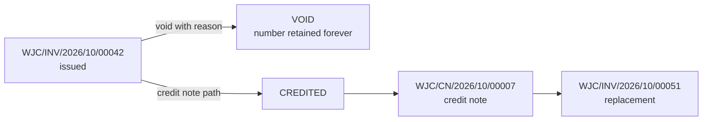

# Document Numbering Standard — WJ-CCTV Business Operations System

| Field | Value |
|---|---|
| Status | Target design — mechanism decided; external format awaits Q-NUM-01 |
| Version | 0.2 — template configuration and MySQL allocation 2026-10-25 |
| Scope owner | The **single authority** on document numbers, allocation, uniqueness, and cancellation |
| Requirement source | [`../PRD.md`](../PRD.md) FR-DOC-004, FR-DOC-006, FR-SYS-004, FR-FIN-011, NFR-DATA-002, BR-FIN-002, BR-FIN-006, §11 |
| Data model | [`../architecture/DATA_MODEL.md`](../architecture/DATA_MODEL.md) §8 |
| Decision record | [`../decisions/ADR-009-mysql-document-number-allocation.md`](../decisions/ADR-009-mysql-document-number-allocation.md) |

---

## 1. Why this document exists

**[Confirmed]** An invoice-numbering conflict has occurred at WJ-CCTV. The exact cause is **unconfirmed**.

This document assumes no cause. It analyses both plausible causes separately, because they require different remedies and only one is solvable inside this system. A centralised platform removes exactly one class of failure — concurrent local generation — and cannot remove the other. Being precise about which is which is the difference between fixing the problem and appearing to fix it.

---

## 2. Two distinct risks

### 2.1 Risk A — Internal duplicate generation

| Aspect | Analysis |
|---|---|
| **Cause** | Read-then-write race (two users read "last = 41", both write 42); `MAX()+1` computed client-side; manual entry in a spreadsheet; number reused after cancellation; two spreadsheets with independent counters; copying a previous invoice without clearing the number |
| **Where it lives** | Entirely inside WJ-CCTV's control |
| **Solvable here?** | **Yes, completely** |
| **Remedy** | Server-side atomic allocation + database uniqueness constraint + immutable issued numbers (§5, §6) |
| **Residual risk** | Near zero if §5 and §6 are implemented and tested under concurrency |

### 2.2 Risk B — Conflict with external numbering rules

| Aspect | Analysis |
|---|---|
| **Cause** | A client's accounting system validates incoming numbers against its own registry; the client requires a specific format, length, or charset; the client treats numbers from different vendors as one namespace; a national registry exists; a required prefix is missing; the number exceeds a field length in the client's system |
| **Where it lives** | Partly or wholly **outside** WJ-CCTV's control |
| **Solvable here?** | **No — not by an internal database alone** |
| **Remedy** | Per-client format configuration after written confirmation; possibly a client-assigned identifier carried alongside our number |
| **Residual risk** | Cannot be eliminated by this system; only reduced by conforming to confirmed external rules |

### 2.3 The claim this document rejects

> **A company prefix does not resolve external conflicts.**

`WJC/INV/2026/10/00001` makes collisions with other vendors *unlikely*. It does not make them impossible, and does not satisfy a client whose system rejects the format outright, requires a fixed length, forbids slashes, or validates against a registry that does not know about WJ-CCTV. Anyone proposing "we'll add a prefix and the problem goes away" is solving Risk A while describing it as Risk B.

### 2.4 What must be confirmed with affected clients — Q-NUM-01

| # | Question | Why it matters |
|---|---|---|
| 1 | Exact permitted length (min/max characters) | A format exceeding a 20-character field will be rejected |
| 2 | Permitted character set (digits only? slashes? hyphens? case?) | Slashes are commonly rejected by ERP import fields |
| 3 | Is a prefix permitted, required, or forbidden? | Determines whether a company prefix helps or hurts |
| 4 | Does the client validate against a national/global registry? | If yes, our numbering must conform to an external authority |
| 5 | Must historical numbers be preserved verbatim? | Determines whether migration may renumber |
| 6 | Are gaps in the sequence acceptable? | Determines whether voided numbers may leave holes |
| 7 | How must a cancelled/voided invoice be represented? | Some clients require a cancellation document with its own number; others a status flag |
| 8 | Is validation per-vendor or global? | A global namespace means our numbers compete with other vendors' |
| 9 | What does the client do on rejection — hard fail or warning? | Determines operational impact |

**Status of all nine: [Open Question].** The internal mechanism in §5–§6 can be built and tested before these answers arrive, because it is format-agnostic: **format is configuration, allocation is correctness.**

**The root cause of the historical conflict remains unconfirmed.** This document must not be cited as evidence that it has been identified.

---

## 3. Design goals

| # | Goal | Non-goal |
|---|---|---|
| G1 | No two documents in one series ever share a number | — |
| G2 | Numbers are human-readable and sortable | Numbers are not meaningful beyond identity |
| G3 | Allocation is atomic under concurrency | — |
| G4 | Issued numbers are permanent | Numbers are not editable to "fix" a mistake |
| G5 | Format is **fully configurable per type** and per client where required | Format is not hard-coded in templates or code |
| G6 | Historical numbers survive migration verbatim | Historical numbers are not renumbered for tidiness |
| G7 | Every allocation is attributable | — |
| G8 | Void gaps are acceptable and expected | Gap-free numbering is **not** a goal |

---

## 4. Number structure and configuration

### 4.1 The template is configuration, not code

**[Confirmed]** The initial invoice format:

```
WJC / INV / 2026 / 10 / 00001
 │     │      │     │     └── 5-digit sequence, zero padded
 │     │      │     └──────── month of the numbering period
 │     │      └────────────── year of the numbering period
 │     └───────────────────── document type code
 └─────────────────────────── company prefix
```

`SUPER_ADMIN` configures, per document type (FR-SYS-004):

| Setting | Meaning | Initial |
|---|---|---|
| `company_prefix` | Company identifier | `WJC` |
| `document_type_code` | Type segment | `INV` |
| `format_pattern` | Ordered token template | `{PREFIX}/{TYPE}/{YYYY}/{MM}/{SEQ}` |
| `separator` | Separator character(s) | `/` |
| `padding` | Sequence padding width | `5` |
| `starting_value` | First value in a new series | `1` |
| `increment_step` | Difference between consecutive allocations | `1` |
| `reset_period` | When the counter restarts | `MONTH` |
| `new_period_rule` | Behaviour at rollover | `RESET_TO_START` |
| `effective_from` | When a change applies | Explicit, never retroactive |

Supported tokens: `{PREFIX}`, `{TYPE}`, `{YYYY}`, `{YY}`, `{MM}`, `{SEQ}`. Unknown tokens are a configuration validation error, not a silent empty string.

### 4.2 Increment step vs void gap — the distinction that must not be conflated

| Concept | Definition | Example |
|---|---|---|
| **Increment step** | Difference between two **consecutive allocated values** | Step 5 ⇒ `00001`, `00006`, `00011` |
| **Void gap** | An issued number whose document was subsequently voided | `00006` issued then voided; the next allocation is still `00011` |

**A step of 5 does not grant permission to reuse a voided number.** The mechanisms are independent: the step controls how far the counter advances; a void changes nothing about the counter, because the number was issued and is retired permanently.

**Terminology flag.** "Gap" is ambiguous in the client's brief — it may mean the arithmetic skip from a step greater than 1, or the hole left by a cancelled document. **[Open Question] Q-NUM-07** requires confirmation. **Proposed default:** the step is an allocation increment (default 1), and "gap" is redefined as a voided-number hole that is never reused. If the business genuinely wants step > 1, configuration supports it — it simply does not authorise reuse.

**Why this matters practically.** A business chasing gap-free numbering will eventually ask to reuse a voided number to "fill the hole". That request is the original defect in a new costume. This section pre-empts it.

### 4.3 Series definition and uniqueness scope

`series_key = {company_prefix}:{document_type}`; `period_key` derives from the document date per `reset_period` (e.g. `2026-10`). One series per type, never shared (FR-DOC-006).

| Scope | Enforced? |
|---|---|
| Company + type + period | **Yes** — `UNIQUE (series_key, document_number)` |
| Across document types | Not required; the type is part of the number |
| Across companies | Not applicable in MVP (single entity) |
| Globally / across vendors | **Cannot be guaranteed** — §2.2 |

### 4.4 Internal ID vs document number

A document number is **never a primary key and never a foreign key**; applications join on UUIDs. Internal IDs are generated on record creation and are globally unique; document numbers are generated only at issuance, unique per series, and mutable never. This prevents a numbering scheme change from cascading through the schema.

### 4.5 Draft vs issued

| State | Has number? | Notes |
|---|---|---|
| Draft | **No** | May show a placeholder clearly marked as not allocated |
| Issued | **Yes** | Allocated atomically at issuance |
| Voided | Yes, retained | Never released or reused |
| Superseded / credited | Yes, retained | The replacement carries its own number |

**Numbers are allocated at formal issuance, never at draft creation** (BR-FIN-002). Allocating at draft time burns numbers on abandoned drafts, creating large gaps and inviting reuse.

---

## 5. Atomic allocation on MySQL / MariaDB

### 5.1 The mechanism

`UPDATE … RETURNING` is **not available** in MySQL, and MariaDB supports `RETURNING` only for `INSERT`/`DELETE` in some versions — so allocation cannot use it. The chosen mechanism is a single-statement update that reads the new value back through the connection's `LAST_INSERT_ID()` register.

```sql
START TRANSACTION;

-- 1. Ensure the counter row exists. Idempotent; the unique key makes a
--    concurrent duplicate a no-op.
INSERT INTO number_series (series_key, period_key, next_value, high_water_mark)
VALUES (:series_key, :period_key, :starting_value, :starting_value - 1)
ON DUPLICATE KEY UPDATE series_key = series_key;

-- 2. Atomically claim the next value. Single statement, no read-then-write.
UPDATE number_series
   SET next_value      = LAST_INSERT_ID(next_value + :step),
       high_water_mark = GREATEST(high_water_mark, LAST_INSERT_ID())
 WHERE series_key = :series_key AND period_key = :period_key;

-- 3. Read back the value claimed on THIS connection.
SELECT LAST_INSERT_ID() AS allocated_value;

-- 4. Render the number server-side from the series configuration.
-- 5. Insert the document with its number and snapshot.
-- 6. Insert the allocation record and the audit event.
-- 7. Render and store the PDF.
COMMIT;
```

**Why this is atomic.** The `UPDATE` holds an exclusive row lock for the transaction, so concurrent issuances serialise on that row and each sees the previous committed `next_value`. `LAST_INSERT_ID(expr)` is connection-scoped, so no other session can observe or overwrite the value between steps 2 and 3.

**Why not `INSERT IGNORE`.** It would satisfy idempotency but swallows *all* warnings, including data truncation — hiding a real error behind a silent success. The explicit no-op update is unambiguous.

**Documented side effect:** `ON DUPLICATE KEY UPDATE` can advance an `AUTO_INCREMENT` counter on a conflicting insert even when no row is written. `number_series` therefore uses a composite natural primary key rather than an auto-increment surrogate, which removes the side effect entirely.

### 5.2 Transactional behaviour

| Property | Behaviour |
|---|---|
| Two concurrent issuances in one series | Two distinct numbers, both succeed |
| N concurrent issuances | N distinct numbers, zero constraint violations |
| Rollback | The increment rolls back; the number is free again |
| Crash mid-transaction | Number not consumed; no orphan document |
| Different series concurrently | No contention between series |

**Rollback returns the number.** Because the increment is an ordinary row update inside the transaction, a failed issuance (PDF error, validation failure) releases the value. A document that never existed should not consume a number — unexplained gaps invite the "reuse the missing number" behaviour that plausibly caused the original conflict.

### 5.3 Prohibited patterns

| Prohibited | Why it fails |
|---|---|
| `SELECT MAX(number) + 1` | Two concurrent transactions read the same maximum |
| `SELECT next_value` then `UPDATE` in application code | The gap between statements is the bug |
| Generating in the frontend or JavaScript | Client state is not authoritative; refresh, double-submit, two tabs |
| Generating in a PDF template, report, or Blade view | Templates are presentation; no transactional context |
| A timestamp as the sequence | Collides under same-second issuance; not a counter |
| A random suffix as the only differentiator | Not human-verifiable, not sortable, still collides |
| An application-level uniqueness check without a DB constraint | The check and insert are not atomic; the constraint is the guarantee |
| A separate numbering service or queue without a transaction | A distributed boundary for no benefit |
| Reusing a voided number | Directly recreates the confirmed failure |
| Lowering `next_value` below `high_water_mark` | Guarantees a future collision |

### 5.4 Concurrency guarantees required

| Property | Requirement |
|---|---|
| N parallel issuances, one series | N distinct numbers, zero violations |
| Parallel issuance with interleaved rollbacks | No duplicates; rolled-back values may be reissued |
| Period rollover | New period gets its own counter at `starting_value` |
| Starting-number change | Future allocations only; never renumbers existing documents |
| Step change | Future allocations only; never alters issued values |
| Deadlock under contention | Bounded retry (3 attempts, exponential backoff) for idempotent transactions; otherwise surfaced |

**Test obligation:** verified by **parallel execution**, not sequential (AC-DATA-002). A sequential test of a numbering bug passes trivially.

### 5.5 Period rollover

The period derives from the **document date** (a business fact), not the server clock, so a backdated document receives its own period's number. Future-dated issuance beyond a configurable window is refused, preventing pre-consumption of the next period.

**Backdating is real.** An invoice for December work may be issued in January with a December date. The number must belong to December's series, or the document's own date contradicts its number — a discrepancy an auditor will question.

---

## 6. Uniqueness enforcement

| Constraint | Purpose |
|---|---|
| `UNIQUE (series_key, document_number)` on `issued_documents` | **The hard guarantee** |
| `UNIQUE (series_key, period_key)` on `number_series` | One counter per series per period |
| `UNIQUE (series_key, period_key, allocated_value)` on `number_allocations` | Prevents double allocation of one value |
| `CHECK (document_number IS NULL OR status <> 'DRAFT')` | A numbered document is never a draft |
| `CHECK (document_number IS NOT NULL OR status = 'DRAFT')` | An issued document always has a number |
| `CHECK (next_value > high_water_mark - 1)` | The counter cannot be lowered into issued territory |

Application-level checks are advisory: two processes can both pass and both insert. Only the constraint is authoritative, and it must exist even when the logic is believed correct — because it catches the bug the logic does not.

**Explicit statement:** frontend validation is never a control (BR-DOC-002). It is convenience. The control is the server-side transaction plus the constraint.

**Engine note:** unique indexes are enforced consistently by MySQL/MariaDB, unlike `CHECK`, which older MySQL 5.7 parses and silently ignores. The `CHECK` constraints above therefore require the engine floor (NFR-DATA-009).

### 6.1 Historical numbers

| Aspect | Behaviour |
|---|---|
| Uniqueness | Enforced — an imported number cannot collide with an issued one |
| Sequence consumption | **None** — imported numbers do not advance the counter |
| Verbatim preservation | Required (BR-DATA-001) |
| Format | May differ from the current pattern; expected |
| Collision at import | Detected in validation; commit blocked (FR-DATA-004) |

**Migration collision policy:** if an imported number collides with another imported number, the import fails with both rows identified. The business decides. The system must not silently pick one and must not renumber — the customer holds a copy with the original number.

---

## 7. Cancellation, voiding, correction

| Rule | Statement |
|---|---|
| V1 | A voided document keeps its number permanently |
| V2 | A voided number is never reissued to a different document |
| V3 | Voiding requires a reason and an authorised actor (FR-FIN-011) |
| V4 | The void is recorded in the audit log and the allocation record |
| V5 | The document remains retrievable, marked `VOID` |
| V6 | A replacement document gets a **new** number |
| V7 | Gaps caused by voids are expected and acceptable |

| | Void | Credit note |
|---|---|---|
| Use when | Document should never have been issued (wrong customer, duplicate, cancelled order) | Document was valid but its value must be reduced or reversed |
| Number effect | Original retained as `VOID` | Original becomes `CREDITED`; credit note has its own number |
| Financial effect | Removed from AR/AP | Offsetting entry in AR/AP |
| Customer communication | "This invoice is cancelled" | "Here is a credit note against invoice X" |



Both chains are traceable through `supersedes_document_id`, `replaced_by_invoice_id`, and `credit_note_for_invoice_id`.

---

## 8. Audit trail for numbering

| Record | Purpose | Content |
|---|---|---|
| `number_series` | Current counter state | Series, period, next value, high-water mark |
| `number_allocations` | Permanent allocation history | Which value, which document, when, by whom, status |
| `audit_events` | Forensic trail | Actor, action, timestamp, before/after, correlation ID |

**Required audit events:** `document_number.allocated` · `document_number.voided` · `document_number.superseded` · `document_series.created` / `.modified` · `document_number.imported` · `number_series.adjusted`.

**Configuration changes are audited** because changing a format mid-year produces numbers that look inconsistent and can break client-side parsing. A change is **never** retroactive and never alters an issued number (FR-SYS-004).

---

## 9. Migration of historical numbers

| Step | Action |
|---|---|
| 1 | Extract all existing document numbers from spreadsheets and documents |
| 2 | Normalise for comparison only (trim, case-fold) — **never** for storage |
| 3 | Detect duplicates within the extracted set; report each with source location |
| 4 | Detect collisions against numbers already imported |
| 5 | Present the conflict list to the business for resolution |
| 6 | Import with `is_historical_import = true`, verbatim strings preserved |
| 7 | Set each series `next_value` **above** the highest existing numeric suffix, and `high_water_mark` to that value, where parseable |
| 8 | Verify: no imported number can be produced by the allocator |

**Step 7 is essential.** If historical invoices ran to `.../00042` and the system starts at 1, the first new invoice collides — a self-inflicted recurrence of the original bug.

**Step 7 caveat:** if historical formats are irregular, a numeric high-water mark may not be computable. The series then starts at a documented offset (e.g. 1000) with the reasoning recorded in the migration report.

**Starting numbers and step changes must not collide with issued or imported documents** (Q-NUM-08). Configuration validation compares the proposed value against `high_water_mark` and every imported number in the series, and refuses a value that could collide.

---

## 10. Testing obligations

| # | Test | Level | Proves |
|---|---|---|---|
| T1 | N parallel issuances in one series | I | No duplicates under concurrency |
| T2 | Concurrent issuances across different series | I | No cross-series contention |
| T3 | Rollback mid-issuance | I | Number not consumed |
| T4 | Duplicate insert directly at DB level | I | Constraint rejects |
| T5 | Client submits a chosen number | I | Server ignores client-supplied numbers |
| T6 | Period rollover at a month boundary | I | New counter at `starting_value` |
| T7 | Backdated invoice uses its date's period | I | Number matches document date |
| T8 | Void retains number; next gets the next value | I | No reuse |
| T9 | Historical import collision detection | I | Blocked before commit |
| T10 | Counter set above the historical high-water mark | I | No post-migration collision |
| T11 | Format change audited; issued numbers unchanged | I | Traceability, non-retroactivity |
| T12 | Issuance failure leaves no numbered document | I | Atomicity across artefacts |
| T13 | Double-submit of issuance | E2E | Idempotency |
| T14 | **Step = 5 produces 00001, 00006, 00011** | I | Step semantics |
| T15 | **Void at 00006 with step 5: next is 00011, never 00006** | I | Step does not license reuse |
| T16 | **Starting-number change refused if it would collide** | I | Q-NUM-08 guard |
| T17 | **Deadlock under contention retried, not corrupted** | I | Bounded retry policy |

Acceptance criteria: AC-DATA-002, AC-DOC-004, AC-DOC-006, AC-FIN-002, AC-FIN-011, AC-DATA-003, AC-DATA-004, AC-SYS-004.

---

## 11. Open questions

| ID | Question | Proposed default | Trigger |
|---|---|---|---|
| Q-NUM-01 | Client format and validation requirements (§2.4, nine questions) | Internal-consistent configurable format; external constraints per client | Before Phase 5 go-live |
| Q-NUM-02 | Prefix including a company legal identifier (e.g. NPWP-derived)? | No — short company code | After accountant input |
| Q-NUM-03 / Q-NUM-06 | **Reset scope: monthly, yearly, or continuous?** | Monthly, matching the initial format example; configurable per series | Phase 1 |
| Q-NUM-07 | **Meaning and permitted range of the configurable "gap"/increment step** | Step = allocation increment, default 1. "Gap" = void hole, never reused. Confirm the business is not asking for reuse | Phase 1 |
| Q-NUM-08 | How starting numbers and step changes interact with existing allocations and imports | Future allocations only; never below high-water mark; audited; refused if collision possible | Phase 1 |
| Q-NUM-05 | Separate cancellation document number required by any client? | Not unless a client requires it | Q-NUM-01 answer #7 |

---

## 12. Invariants

1. **Numbers are generated only on the server, inside the issuing transaction.**
2. **No `MAX()+1`, no read-then-write, no client-side generation.**
3. **A database constraint enforces uniqueness — not application logic alone.**
4. **Issued numbers are immutable and never reused, including after void.**
5. **Numbers are allocated at formal issuance, never at draft creation.**
6. **Historical numbers are preserved verbatim and never renumbered.**
7. **Void gaps are acceptable; reuse is not.** A configured increment step does not authorise reuse.
8. **A company prefix does not guarantee external uniqueness** — external constraints require client confirmation.
9. **Configuration changes never alter an issued number and are never retroactive.**
10. **The counter is never lowered below the historical high-water mark.**

---

## 13. Cross-references

- Requirements: [`../PRD.md`](../PRD.md) §6.6, §11
- Entities: [`../architecture/DATA_MODEL.md`](../architecture/DATA_MODEL.md) §8
- Issuance flow: [`../workflows/FINANCE_AND_DOCUMENTS.md`](../workflows/FINANCE_AND_DOCUMENTS.md) §4, §8
- Decision: [`../decisions/ADR-009-mysql-document-number-allocation.md`](../decisions/ADR-009-mysql-document-number-allocation.md)
- Tests: [`../implementation/TESTING_STRATEGY.md`](../implementation/TESTING_STRATEGY.md) §4
