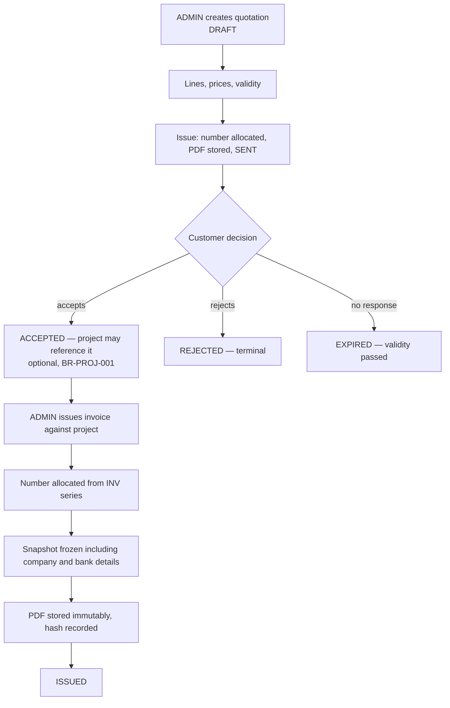
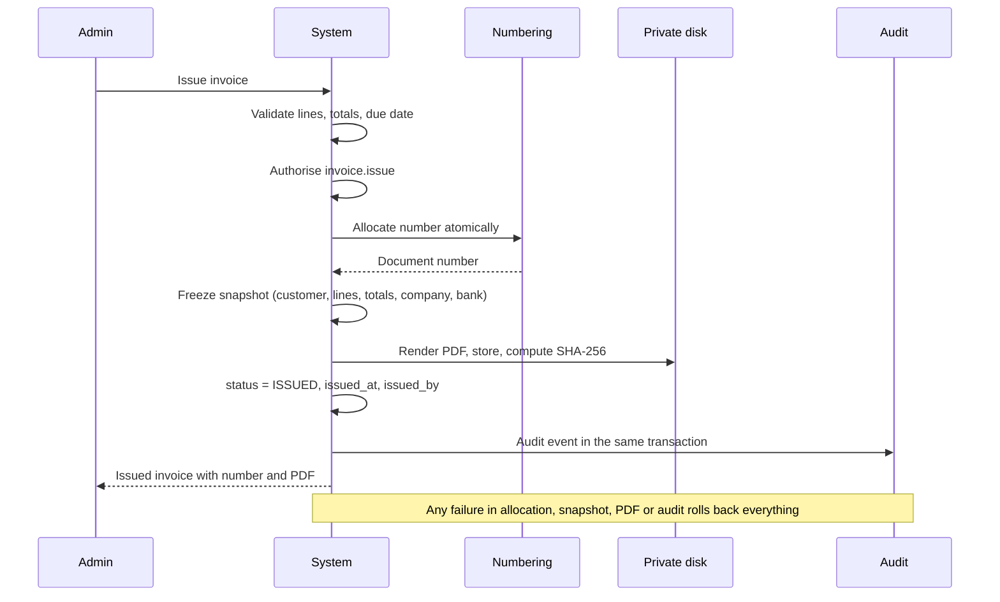
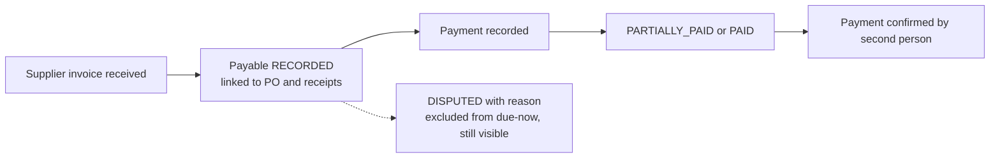

# Finance and Documents — WJ-CCTV Business Operations System

| Field | Value |
|---|---|
| Status | Target design |
| Version | 0.2 — storage and company snapshot reconciled 2026-10-25 |
| Scope owner | Quotations, invoices, payments, payables, expenses, AR/AP, document generation and history, correction procedures |
| Requirement source | [`../PRD.md`](../PRD.md) §6.6, §9.6–9.10, §10 |
| Numbering authority | [`../standards/DOCUMENT_NUMBERING.md`](../standards/DOCUMENT_NUMBERING.md) |
| Data model | [`../architecture/DATA_MODEL.md`](../architecture/DATA_MODEL.md) §7, §8 |

---

## 1. Three layers, kept separate

| Layer | Answers | MVP | Tables |
|---|---|---|---|
| **L1 — Operational finance and cash tracking** | What came in, what went out, what did this project cost? | In scope | `payments`, `expenses`, `project_cost_entries` |
| **L2 — AR/AP** | Who owes us, whom do we owe, how overdue? | In scope | `invoices`, `payables`, `payment_allocations` |
| **L3 — Formal accounting** | What are the statutory statements? | **[Out of Scope]** (Q-FIN-01) | none |

The business needs to chase receivables and pay suppliers. It has not confirmed needing journals, a chart of accounts, or tax filings produced by this system. Building a general ledger without an accountant's requirements produces statements nobody can file; building AR/AP and cash tracking produces immediate operational value. **The boundary is a decision, not an oversight.** When Q-FIN-01 is answered affirmatively, L3 is scoped as a separate module that *consumes* L1/L2 data — it does not replace them.

---

## 2. Document types

| Type | Series | Issued when | Immutable after issuance |
|---|---|---|---|
| Quotation | `QUO` | Sent to customer | Yes |
| Supplier Purchase Order | `PO` | Sent to supplier, **only after `PEMILIK` approval** | Yes |
| Sales Invoice | `INV` | Billed to customer | Yes |
| Credit Note | `CN` | Correcting an invoice | Yes |
| Receipt | `RCP` | Payment received from customer | Yes |
| Delivery/Work Order document | `WO` | Work assigned (optional print) | Yes |
| Supplier Payable reference | `PAY` (optional) | Supplier invoice recorded | Internal only |

**Customer POs are not our documents.** A customer's PO number is recorded as data and never enters our numbering series. Confusing the two is a real risk in small businesses and produces numbering conflicts.

**Numbering rules are not restated here** — one authority, one place: [`../standards/DOCUMENT_NUMBERING.md`](../standards/DOCUMENT_NUMBERING.md). The initial invoice format is `WJC/INV/2026/10/00001`, and it is **configuration, not code**.

---

## 3. Quotation → invoice



BR-PROJ-001: a project may exist without a quotation — many small jobs are agreed verbally or over WhatsApp. The system must support that path without friction: no warning wall, no forced "no quotation" reason. Systems that require a quotation for every project get abandoned by businesses that do small jobs.

**A quotation is not revenue.** An accepted quotation creates no receivable and no revenue; only an issued invoice does. Treating a quotation as a financial event inflates reported revenue and creates phantom receivables.

---

## 4. Invoice issuance

### 4.1 Issuance — one transaction



A number cannot be consumed without a document, and a document cannot exist without a number.

### 4.2 The snapshot

FR-FIN-003 and BR-SYS-001 require that later master-data edits do not alter issued documents. The snapshot captures, at issuance: customer name, address, and contact · **company name, address, contact, and logo reference** · **bank name, account number, and account holder** · line descriptions, quantities, and unit prices · totals, discount, and tax · currency, invoice date, and due date.

**Why denormalisation is correct here:** normalisation exists to avoid update anomalies in mutable data. An issued invoice is not mutable data — it is a historical fact, and storing the fact as it was is the only correct representation.

**The failure this prevents:** the company moves bank account, or renames itself, and a reprinted invoice no longer matches what the customer received — potentially directing payment to an account that no longer exists. M4 requires byte-identical re-download after such changes.

### 4.3 Draft vs issued

| | Draft | Issued |
|---|---|---|
| Document number | None | Allocated, permanent |
| Editable | Yes | **No** |
| Appears in AR | No | Yes |
| Has PDF | No (preview only) | Yes, stored |
| Counts in reports | No | Yes |

The distinction must be visible everywhere — lists, PDFs, reports, exports. A draft that looks like an invoice causes accidental double-billing.

---

## 5. Payments and allocation

### 5.1 Recording vs confirming

| | Recorded | Confirmed |
|---|---|---|
| Who | `ADMIN`, `PEMILIK`, `SUPER_ADMIN` | A second authorised person (`PEMILIK`, or `ADMIN` via override) |
| Meaning | "A payment reportedly happened" | "Someone verified it happened" |
| Effect on AR/AP | Reduces balance | Reinforces; enables reporting confidence |
| Reversible | Yes (reverse with reason) | Yes (reverse with reason) |

**Why two steps:** the confirmed operating condition is that the owner sometimes transfers funds personally. The person recording may be reacting to a WhatsApp message saying "already transferred". Without confirmation, an unverified claim reduces receivables and hides a real debt.

### 5.2 Allocation rules

Partial payment allowed, leaving `PARTIALLY_PAID` · one payment may allocate across several invoices · overpayment becomes an unapplied credit, never a negative balance (BR-FIN-003) · an allocation exceeding the balance is refused with the remaining balance shown · an unallocated payment is allowed and appears as an unapplied credit · reversal creates a compensating record and retains the original.

### 5.3 Derived figures

```
outstanding = total_amount − SUM(allocations on non-reversed payments)
overdue     = due_date < today AND status ∈ {ISSUED, PARTIALLY_PAID}
```

Both are computed, not stored as editable fields. `amount_paid` is a cache with a reconciliation path (DATA_MODEL §11). `OVERDUE` is a **derived display state**, not a stored transition (PRD §9.8) — deriving it means no nightly job can leave a stale flag and no user can accidentally clear it.

---

## 6. Payables



**[Assumption]** some supplier purchases happen without a PO (an urgent retail purchase by a technician). The model allows a payable without a PO link, flagged so it appears in a control report. Blocking such payables outright would push these purchases outside the system entirely — worse than recording them imperfectly. **This does not weaken the approval rule:** a purchase without a PO is still a purchase, and if unapproved it appears as an exception for the owner to review.

A payable may be `DISPUTED` with a reason; disputed payables are excluded from "due now" totals but remain visible, which prevents both premature payment and silent forgetting.

---

## 7. Expenses

Project expenses are linked to a project and enter project cost; operational expenses enter company overhead. Examples: fuel and tolls for site visits, equipment rental, consumables, office costs.

**[Assumption]** technicians may incur small cash expenses. **[Proposed]** MVP allows office staff to record expenses on a technician's behalf; technician self-service entry is deferred, because the reimbursement workflow (approval, receipt capture, payout) is a distinct feature and recording is enough for cost visibility.

---

## 8. Correction procedures

**An issued document is never edited.** Not by `PEMILIK`, not by `ADMIN`, not by `SUPER_ADMIN`, not by a database fix in normal operation (BR-FIN-001, BR-FIN-004). Administrative privilege does not include the right to rewrite history.

| Situation | Correct procedure | Never do this |
|---|---|---|
| Wrong amount on an issued invoice | Credit note for the full amount, then a replacement invoice | Edit the invoice |
| Wrong customer name | Credit note + replacement invoice, or a documented addendum | Edit the snapshot |
| Invoice issued to the wrong customer | Void with reason, reissue to the correct customer | Reassign the invoice |
| Customer disputes one line | Credit note for that line only | Edit the line |
| Invoice number rejected by the client | Void, reissue under an accepted format (after Q-NUM-01) | Change the number on the issued document |
| Payment recorded in error | Reverse with reason; record the correct payment | Delete the payment |
| Duplicate invoice created | Void the duplicate with reason referencing the original | Delete it |
| Company bank account changed | Nothing — the issued document keeps its snapshot | Regenerate the PDF with new details |

**Why voiding beats deletion.** A voided invoice keeps its number, which is never reused (BR-FIN-002). The audit trail shows: issued at T1 by A, voided at T2 by B with reason R. If the document were deleted, the business would have no evidence it ever existed — and a customer producing a copy would create an unexplainable discrepancy.

**Gaps are acceptable and expected.** A gap means "a document was issued and voided", a normal business event. Chasing gap-free numbering leads businesses to reuse numbers — precisely the failure mode that caused the original conflict (BR-FIN-006).

**Interaction with payments.** Voiding after partial payment reverses the allocations, leaving an unapplied credit; a refund or reallocation is a separate recorded action. A credit note after full payment leaves the customer with a credit balance, refunded as an outbound payment. **Principle:** voiding a document never erases a cash movement — money that arrived is a fact independent of the paperwork describing it.

---

## 9. Document generation and history

| Aspect | Rule |
|---|---|
| When | At issuance only |
| Storage | **Private local disk** outside the webroot, immutable (FR-DOC-001) |
| Reference | `disk` + relative `path` + SHA-256 — never an absolute URL (FR-DOC-009) |
| Hash | SHA-256 recorded at generation (FR-DOC-003) |
| Regeneration | Only as a new derived artefact; never replaces original bytes (FR-DOC-008) |
| Layout | Company header and logo, document number, date, party, lines, totals, **bank details from the snapshot**, terms, signature block |
| Language / currency | Indonesian (NFR-OPS-007) · IDR |

**Why store the PDF rather than regenerate on demand:** regeneration from live data is how issued documents silently change. Storing the bytes makes the historical artefact verifiable against its hash. If the template is later redesigned, old documents keep their original appearance — what a customer expects when reopening a file received last year.

**History** shows the document (number, type, status, issue date, actor), the snapshot (customer, lines, totals, company and bank details as issued), the original PDF, related credit notes, replacements, payments and project, and a timeline with actors.

**Retrieval** is by document number or by entity. Numbers are unique per series (NFR-DATA-002); a number without its series prefix may be ambiguous across types, so lookup requires a type or resolves across series with the type shown. **Downloads are authorised per request** — a technician cannot download an invoice attachment, and an issued PDF is reachable only by roles holding `invoice.read.all` (AC-DOC-007, AC-DOC-010).

---

## 10. AR/AP reporting

| Report | Content | Requirement |
|---|---|---|
| AR ageing | Per customer: current, 1–30, 31–60, 61–90, 90+ | FR-FIN-005, FR-RPT-004 |
| AP ageing | Per supplier: same buckets | FR-FIN-010, FR-RPT-004 |
| Outstanding invoices | Per invoice: issued, paid, outstanding, days overdue | FR-FIN-005 |
| Project billing status | Per project: billed, paid, outstanding | FR-RPT-002 |
| Unbilled completed work | Completed projects with unbilled scope | PROJECT_LIFECYCLE §6.3 |
| Override report | All financial overrides with reasons | FR-AUD-004 |
| Unapproved purchases | Purchases with no `PEMILIK` approval, including no-PO cases | FR-PROC-011 |

**[Proposed]** ageing is computed from **due date**, not invoice date, because due date determines lateness; both are displayed so the office can see the difference.

---

## 11. Project cost

| Source | Recognised? | Notes |
|---|---|---|
| Goods receipt | **Yes** (proposed default) | Cost exists when material exists |
| Supplier invoice | No (view of the same cost) | Recorded for AP |
| Payment | No (view of the same cost) | Recorded for cash |
| Material issue/consumption | No | Physical movement, not a new cost |
| Expense | Yes | Distinct cost |
| Labour | **No** in MVP | **[Open Question]** whether labour cost is needed for profitability |

**Double-counting control:** `UNIQUE (project_id, source_type, source_id)` on `project_cost_entries` (BR-FIN-005). The subtle failure this prevents: a project showing material cost at three times the real value because receipt, invoice, and payment were each added — producing a business that appears unprofitable on profitable jobs and leading to wrong pricing decisions.

---

## 12. Tax and statutory considerations

**[Open Question] Q-FIN-01 / Q-FIN-03** — tax obligations are unconfirmed: whether PPN (VAT) applies and at what rate · whether invoices must show a *faktur pajak* format · whether PPh withholding is required · whether e-Faktur integration is required.

**[Proposed] default:** the invoice model carries `tax_amount` and a configurable rate, displayed as a line. No statutory format, no e-Faktur integration, no filing. **Decision trigger:** accountant confirmation in Phase 0.

**Why not guess:** tax formatting errors on issued invoices create legal exposure. A neutral, correct invoice without statutory claims is safer than a wrong imitation of one.

---

## 13. Failure behaviours

| Failure | Required behaviour |
|---|---|
| Number allocation fails | No invoice created; clear Indonesian error; no partial state |
| PDF generation fails | Transaction rolls back; number not consumed |
| Private disk unavailable at issuance | Issuance fails; **no numbered document without its PDF** |
| Duplicate submission of issuance | Idempotent; one invoice, one number |
| Payment exceeds balance | Refused with the remaining balance shown |
| Concurrent payments on one invoice | Serialised; total allocation never exceeds the balance |
| Snapshot missing on an issued invoice | Refused at issuance |
| Company profile edited after issuance | Issued documents unchanged; hash still matches |
| Download requested by an unauthorised role | 403 before any file handle is opened |

---

## 14. Acceptance criteria references

| Behaviour | AC |
|---|---|
| Quotation issued with number and PDF | AC-FIN-001 |
| Invoice issued with an allocated number | AC-FIN-002 |
| Issued invoice immutable after customer, item, **or company** edit | AC-FIN-003 |
| Partial payments and accurate outstanding | AC-FIN-004 |
| Overdue derived from due date | AC-FIN-005 |
| Project cost not double counted | AC-FIN-007 |
| Payment recorded ≠ confirmed | AC-FIN-009 |
| Void retains number and record | AC-FIN-011 |
| Credit note and replacement preserve the original | AC-FIN-012 |
| Private local storage; no public URL | AC-DOC-001 |
| Issued PDF immutable | AC-DOC-008 |
| Storage abstraction allows S3 migration without rewrite | AC-DOC-009 |
| Download requires authorisation; streamed with disposition | AC-DOC-010 |
| Company details and bank snapshotted at issuance | AC-SYS-003 |
| SMTP credentials encrypted and write-only | AC-SYS-001 |

---

## 15. Cross-references

- Numbering: [`../standards/DOCUMENT_NUMBERING.md`](../standards/DOCUMENT_NUMBERING.md)
- Audit: [`../standards/AUDIT_LOGGING.md`](../standards/AUDIT_LOGGING.md)
- Payables from procurement: [`./PROCUREMENT_AND_MATERIALS.md`](./PROCUREMENT_AND_MATERIALS.md) §3.5
- Project closure and billing: [`./PROJECT_LIFECYCLE.md`](./PROJECT_LIFECYCLE.md) §6
- Finance permissions: [`../architecture/SECURITY_AND_ACCESS_CONTROL.md`](../architecture/SECURITY_AND_ACCESS_CONTROL.md) §3.2
- Storage decision: [`../decisions/ADR-006-private-file-storage.md`](../decisions/ADR-006-private-file-storage.md)
