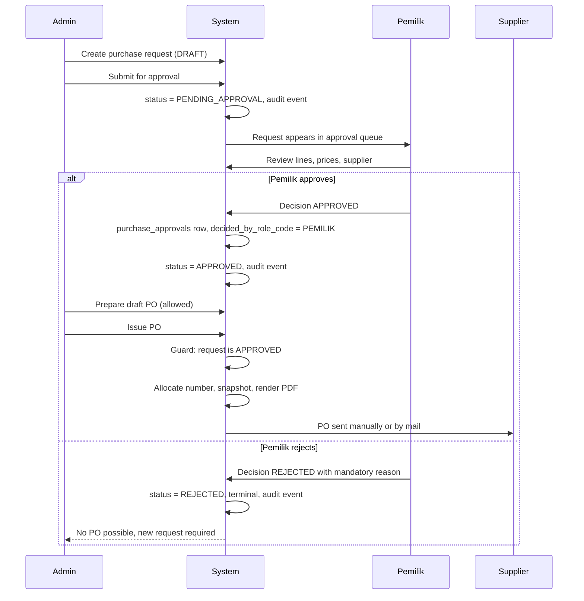
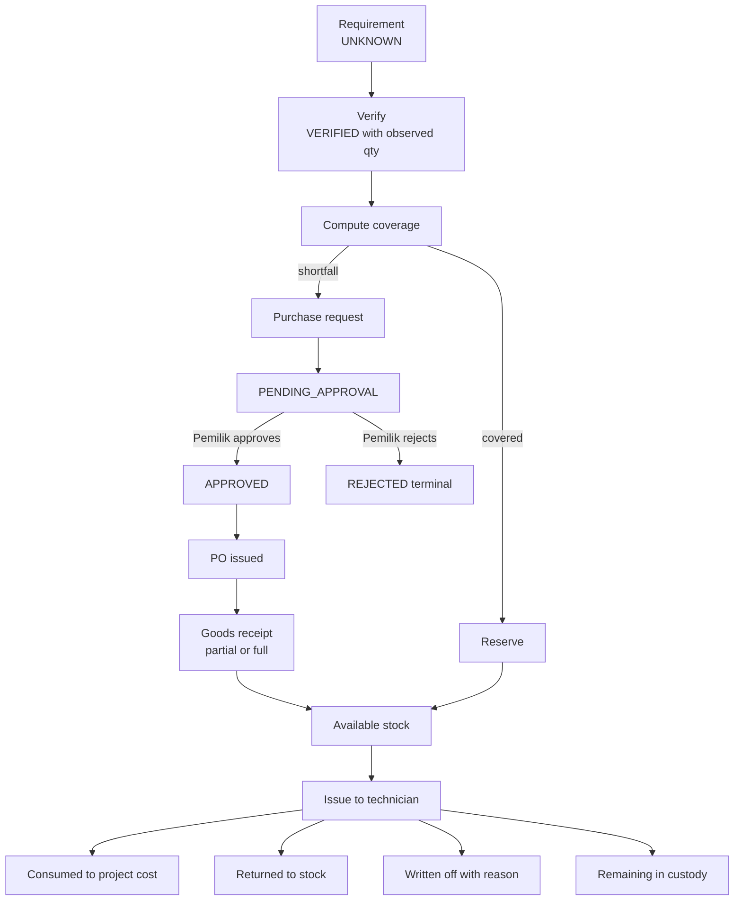

# Procurement and Materials — WJ-CCTV Business Operations System

| Field | Value |
|---|---|
| Status | Target design |
| Version | 0.2 — approval rule and engine reconciled 2026-10-25 |
| Scope owner | Material requirements, stock status, reservations, the movement ledger, purchasing, approval, goods receipt, issue/consumption/return, material readiness |
| Requirement source | [`../PRD.md`](../PRD.md) §6.3, §6.4, §9.3–9.7, §8 |
| Data model | [`../architecture/DATA_MODEL.md`](../architecture/DATA_MODEL.md) §5, §6 |

---

## 1. Design position

**[Confirmed]** operating conditions: no centralised inventory, materials tracked per project; not all required materials are on hand; office administration handles purchasing and PO preparation; **the owner approves every purchase** and may personally transfer funds.

The business does not need a warehouse ERP. It needs to answer, per project: what does this project require · do we actually have it, and do we *know* we have it · if not, what must be bought, who approved it, and where is that purchase · what did we hand the technician, and what came back.

Anything serving a fifth question (bin locations, lot tracking, cycle counting) is deferred (Q-INV-01).

| In MVP | Deferred |
|---|---|
| Item catalogue; requirement lines per project | Multi-location stock; bin/shelf locations |
| Stock status `UNKNOWN`/`VERIFIED` | Lot/batch and serial tracking |
| Reservations | Barcode scanning; cycle counting |
| Request → **Pemilik approval** → PO → receipt | Stock valuation (FIFO/average) |
| Issue / consume / return / write-off | Transfers between locations |
| Movement ledger + reconciliation | |

---

## 2. The unknown-stock policy

### 2.1 The failure it prevents

A spreadsheet cell says `20` next to "Kabel UTP". Nobody knows whether that is 20 boxes, 20 metres, or a number typed eight months ago. A project reserves 20. A second project also reserves 20. Both proceed. One aborts on site — costing a technician's day, a customer's trust, and an emergency retail purchase.

The root cause is not a wrong number: it is that **a number of unknown provenance was treated as verified fact.**

### 2.2 The policy

| Rule | Statement |
|---|---|
| **U1** | Every line carries `stock_status` ∈ {`UNKNOWN`, `VERIFIED`}; new lines default `UNKNOWN` (FR-MATL-002) |
| **U2** | An `UNKNOWN` quantity is **never** available — it cannot be reserved, cannot count toward readiness, cannot offset a shortfall |
| **U3** | A line becomes `VERIFIED` only through an explicit verification recording the observed quantity, user, and timestamp (FR-MATL-003) |
| **U4** | Verification is a physical or authoritative act; never inferred from a PO, a delivery note, or a previous project's usage |
| **U5** | A reservation may exist only on a `VERIFIED` line; otherwise the system refuses and names the blocking condition (FR-MATL-005) |
| **U6** | Verification may be invalidated (recount differs): the line returns to `UNKNOWN` and its reservations are re-evaluated |

**Explicitly rejected:** "default to available", a "trust the spreadsheet" import flag, or an "assume 0 is fine" shortcut. Each reintroduces the failure the system exists to prevent.

### 2.3 What verification looks like

Office staff check the shelf, or a trusted record, and enter: item, observed quantity, unit, location note, optional note. That single action converts an assumption into a fact — seconds of work, the cheapest possible control against a costly failure.

**[Assumption]** verification is performed by office staff. If material is stored elsewhere, or a technician must verify on arrival, `material.verify` can be granted more widely — the *act* remains mandatory regardless of who performs it.

---

## 3. The full chain

### 3.1 Requirement → verification → coverage

A requirement line states need and carries no availability implication. Lines are editable while the project is `DRAFT`/`PLANNED`; once reserved or ordered, changing one requires releasing reservations first. `stock_status = UNKNOWN`, `fulfilment_status = DRAFT`.

Verification is per line, not per project. Partial verification is normal: five verified, two unknown — readiness reflects this honestly (`REQUIREMENTS_INCOMPLETE`). A `stock_verifications` row is appended, preserving history.

| Quantity | Definition |
|---|---|
| `required` | What the project needs |
| `on_hand_verified` | What was observed at verification |
| `reserved_by_others` | Active reservations on the same item held by other projects |
| `available_to_this_line` | `on_hand_verified − reserved_by_others` |
| `covered` | `min(required, max(0, available_to_this_line))` |
| `shortfall` | `required − covered` |

`shortfall` is what must be purchased (FR-MATL-007) — the single calculation connecting materials to procurement, computed atomically so two projects cannot both claim the same units (§5.2).

### 3.2 Reservation

> A reservation is a **claim on verified stock**, not a physical movement. It reduces what other projects may claim. It does not move anything, change location, or appear as a quantity movement.

This is why reservations live in their own table rather than as a movement type. Conflating "reserved" with "moved" produces systems where nobody can tell what is physically on the shelf.

### 3.3 Purchase request

A request may aggregate shortfalls across projects (one cable order for three jobs), with each line retaining its link to the requirement line so cost is attributable.

**Two origins:** `ADMIN` prepares requests from shortfall; a `TEKNISI` may raise an **additional material request** for their own project (FR-MATL-014). Both enter the same approval flow, and a technician sees only their own request's status.

### 3.4 Approval — mandatory, Pemilik only

**No threshold, no auto-approval, no delegation, no below-threshold exception** (FR-PROC-011, BR-PROC-005). An override can never waive this step.

**The state distinction that matters most** (BR-PROC-001):

| Event | Means | Does **not** mean |
|---|---|---|
| Approval | `PEMILIK` said yes | Money spent, goods ordered, goods received |
| PO issued | A document was sent to a supplier | Goods delivered, invoice received, money paid |
| Goods received | Physical items arrived and were counted | Invoice received, money paid |
| Payable recorded | Supplier billed us | Money paid |
| Payment recorded | A transfer reportedly happened | Payment verified |
| Payment confirmed | A second authorised person verified it | — |

Collapsing these is the operational failure the business currently lives with. Each is a separate row, a separate timestamp, a separate actor.

### 3.5 PO, delivery, payable, payment

`ADMIN` may prepare a **draft** PO before approval (FR-PROC-012). Issuing is different: it allocates a number, freezes the snapshot, and commits the company. Issuance is refused unless the request is `APPROVED`, and the refusal has **no side effects** — no number consumed, no snapshot, no PDF. A PO without a number is a draft and must be visibly distinguishable everywhere.

**BR-MATL-005 is absolute:** a PO does not increase available stock; only a posted goods receipt does. A system showing stock as available at PO issuance causes the exact double-promising failure of §2.1. Partial receipt is a first-class case — each receipt is its own record with its own date, lines, and discrepancies.

A supplier invoice may arrive before, with, or after delivery; the payable exists independently of the receipt. Discrepancies (invoice ≠ PO price, invoice for undelivered goods) are recorded, not silently accepted.

`ADMIN` or `PEMILIK` records the payment; a separate confirmation marks it `CONFIRMED`. **No bank integration exists** (BR-PROC-004). **[Confirmed]** the owner may personally transfer funds — in that case the recording user is often `PEMILIK` and the confirmer should be a different authorised person; where impossible, the override path applies with reason and `PEMILIK` visibility.

### 3.6 End-to-end

---

## 4. Reservation lifecycle

| State | Meaning | Exits |
|---|---|---|
| `ACTIVE` | Quantity claimed; reduces availability for other projects | → `RELEASED`, → `CONSUMED` |
| `RELEASED` | Claim withdrawn; quantity returns to availability | terminal |
| `CONSUMED` | Reserved quantity was issued and used | terminal |

| From | To | Trigger | Rule |
|---|---|---|---|
| — | `ACTIVE` | Office reserves | Line must be `VERIFIED`; available ≥ requested |
| `ACTIVE` | `RELEASED` | Project cancelled, requirement reduced, material no longer needed | Release reason required |
| `ACTIVE` | `CONSUMED` | Material issued to technician | Issue quantity ≤ reserved, or the excess is unreserved and re-checked |

| Event | Reservation effect |
|---|---|
| Project cancelled | All `ACTIVE` released (BR-PROJ-005 flow) |
| Requirement quantity reduced | Excess released first, then the reduction applies |
| Requirement line removed | Must be released before removal is permitted |
| Work order cancelled | No automatic effect; reservations are project-scoped |
| Project closed | Any `ACTIVE` must be resolved before closure (closure condition 2) |

| | Movement | Reservation |
|---|---|---|
| Physical meaning | Something moved | Nothing moved |
| Affects shelf count | Yes | No |
| Affects availability for others | Indirectly | Directly |
| Reversible | Only by compensating entry | By release |

Keeping these separate means the physical ledger stays true even when commercial plans change.

---

## 5. Preventing double-counting across projects

### 5.1 The three failure modes

| # | Failure | Cause | Consequence |
|---|---|---|---|
| F1 | Same units promised to two projects | No reservation concept, or reservations not netted | One project aborts on site |
| F2 | Same cost counted twice | Receipt, invoice, and payment each counted as project cost | Inflated cost, wrong margin |
| F3 | Quantity drifts from reality | Direct quantity edits, untracked issues/returns | Stock figure is fiction |

### 5.2 Controls for F1 — quantity

Verified-only reservation (U5) · net-of-others availability (§3.1) · atomic evaluation via a conditional single-row `UPDATE` on the item balance, or `SELECT … FOR UPDATE` by primary key, with check and insert in one transaction · a database constraint that raises rather than warns · periodic reconciliation (FR-MATL-013).

**Concurrency test obligation:** two simultaneous reservations for the last available units must produce exactly one success and one refusal. A sequential test proves nothing (AC-MATL-006).

**Engine note:** MySQL's default `REPEATABLE READ` uses gap locks, so a range lock can block more rows than intended. The chosen mechanism is `UPDATE … WHERE available >= :qty` (atomic without an explicit lock) or `FOR UPDATE` **by primary key**. Deadlocks are retried under a bounded policy (DATA_MODEL §1.4).

### 5.3 Controls for F2 — cost

Cost is recognised at **goods receipt** (proposed default), not at PO or payment · `UNIQUE (project_id, source_type, source_id)` on `project_cost_entries` · supplier invoice and payment are *views* of the same cost, excluded rather than added · a variance is an explicit adjustment entry with reason, never a silent overwrite · the composition report (FR-FIN-007) makes a double count visible.

**[Open Question] Q-COST-01 — Recognition point.** Receipt (accrual at delivery) vs supplier invoice vs payment (cash basis). **Proposed default:** goods receipt, because the business cares about cost as soon as material exists on site. **Decision trigger:** accountant input (Q-FIN-01). Only **one** point recognises cost; the others are excluded by constraint.

### 5.4 Controls for F3 — quantity integrity

Append-only ledger with no update/delete path · no editable quantity in any UI or API · corrections as reversal rows · `CHECK (consumed + returned + written_off ≤ issued)` · reconciliation checkpoints.

### 5.5 Reconciliation checkpoints

| Checkpoint | When | Compares |
|---|---|---|
| Pre-issue | Before handing material to a technician | Reserved vs required vs available |
| Post-return | When an issue is closed | Issued vs consumed + returned + written off |
| Pre-closure | At project closure | All lines in a terminal fulfilment state |
| Periodic | Weekly/scheduled | Ledger sum vs cached balance per item |
| Post-migration | After spreadsheet import | Imported quantities vs first physical count |

A variance is never auto-corrected. It is reported, investigated, and resolved with a documented adjustment.

---

## 6. Issue, consumption, return, damage

| Step | Effect |
|---|---|
| **Issue** | `material_issues` (`OPEN`) + lines; `ISSUE_OUT` movements; reservation `CONSUMED` where applicable. Custody transfers to the technician — which is why closure requires every issue resolved |
| **Consumption** | `consumed_quantity` increases; `CONSUME` movement. Material becomes project cost (subject to Q-COST-01) |
| **Return** | `returned_quantity` increases; `RETURN_IN` movement; availability restored. Usable by another project after verification if condition is in doubt |
| **Write-off** | `written_off_quantity` increases; `WRITE_OFF` movement with reason code |

**Write-off reason codes:** `DAMAGED_ON_SITE`, `DAMAGED_IN_TRANSIT`, `LOST`, `OBSOLETE`, `THEFT`, `OTHER`.

Write-off is not silent deletion. The quantity remains visible in the ledger and the project report, marked as lost — which is what makes loss visible to the owner, the opposite of material simply ceasing to be mentioned.

**Invariant, always:** `consumed + returned + written_off ≤ issued`. Remaining (in technician custody) = `issued − consumed − returned − written_off`. A project cannot close while any issue line has remaining > 0.

---

## 7. Material readiness status

Defined in [`../PRD.md`](../PRD.md) §9.3. **Derived, never hand-set.**

| Status | Derivation |
|---|---|
| `NOT_ASSESSED` | No requirement lines |
| `REQUIREMENTS_INCOMPLETE` | ≥1 line with `stock_status = UNKNOWN` |
| `AWAITING_PROCUREMENT` | All verified but ≥1 unresolved shortfall |
| `READY_TO_START` | All non-optional lines covered by verified stock or received goods |
| `PARTIALLY_ISSUED` | Some quantity issued, not all |
| `FULLY_ISSUED` | All required quantity issued |
| `CLOSED` | All issued quantity consumed/returned/written off |

| Project status | Readiness | Permitted? |
|---|---|---|
| `SCHEDULED` | `READY_TO_START` | Yes — normal |
| `SCHEDULED` | `AWAITING_PROCUREMENT` | Yes — scheduling ahead of purchasing is normal |
| `IN_PROGRESS` | `READY_TO_START` / `PARTIALLY_ISSUED` | Yes |
| `IN_PROGRESS` | `AWAITING_PROCUREMENT` / `REQUIREMENTS_INCOMPLETE` | **Only with override + reason** (BR-PROJ-003) |
| `CLOSED` | not `CLOSED` | **Refused** (closure condition 2) |

The override exists because site work sometimes starts with partial materials (cabling before cameras arrive). It is logged and visible to `PEMILIK`, converting a workaround into a monitored pattern. Frequent overrides are evidence the readiness model needs adjustment — not evidence the override should be removed.

---

## 8. Purchasing and approval detail

### 8.1 The rule, stated once

**Every purchase request requires explicit `PEMILIK` approval before a PO may be issued.** No threshold, no auto-approval, no delegation, no below-threshold exception (FR-PROC-011, BR-PROC-005).

| Aspect | Behaviour |
|---|---|
| Who may approve | `PEMILIK` only. No other role holds `purchase.approve`, `SUPER_ADMIN` included |
| Self-approval | Not applicable — the requester can never be the approver, because `ADMIN` and `TEKNISI` cannot approve at all |
| Rejection | Requires a reason; terminal for that request (a new request is raised if needed) |
| Re-submission | A rejected request is not edited back to `PENDING_APPROVAL`; a new request preserves the rejection |
| Time limit | No auto-approval, no timeout escalation. An unapproved request stays `PENDING_APPROVAL` and appears in an ageing report |
| Override | **Never applies.** An override may bypass an authorisation conflict, never this requirement |
| Enforcement | Server-side state guard **plus** a database constraint/trigger; hiding the button is not the control (AC-PROC-011/012) |

**[Confirmed]** the previous approval-threshold question is **resolved** (Q-PROC-01, 2026-10-25). The prior "fail-closed policy engine" design is withdrawn with it (FR-PROC-003 marked `WITHDRAWN`).

### 8.2 What `ADMIN` may do before approval

| Allowed pre-approval | Forbidden pre-approval |
|---|---|
| Create and edit the request | Issue a supplier PO |
| Attach quotations or price indications | Send any document committing the company |
| Prepare a **draft** PO | Allocate a PO number |
| Verify stock and reserve | Record a goods receipt against a PO never issued |
| Request supplier quotes verbally | Record a payable as if ordered |

The draft PO exists so preparation is fast once approval arrives. It is visibly `DRAFT` and carries no number.

### 8.3 Partial delivery, partial payment, discrepancies

| Case | Handling |
|---|---|
| Partial delivery | Multiple receipts against one PO; `PARTIALLY_RECEIVED` |
| Over-delivery | Blocked unless an explicit over-receipt approval is recorded (BR-PROC-003) |
| Under-delivery never completed | Stays `PARTIALLY_RECEIVED`; ageing report surfaces it |
| Wrong item / damaged on arrival | Discrepancy recorded; stock increases only for accepted quantity |
| Partial payment | Multiple allocations; `PARTIALLY_PAID` |
| Overpayment | Unapplied credit, never a negative balance (BR-FIN-003) |
| Payment before invoice | Allowed; the payable is created and immediately allocated |
| Price higher than PO | Recorded; requires resolution (accept with reason, or dispute) |
| Quantity higher than received | Blocked until goods are received or the invoice is disputed |
| Invoice for a cancelled PO | Blocked; requires explicit handling |
| Duplicate supplier invoice number | Warned and flagged, not silently accepted |

**[Open Question] Q-PROC-02 — Supplier delivery and goods-receipt practices.** Whether suppliers provide delivery notes and how discrepancies are handled is unconfirmed. **Proposed default:** capture an optional delivery-note reference and support discrepancy recording; do not require a delivery note.

---

## 9. Migration path: project-scoped → centralised stock

The ledger, item catalogue, reservation model, and reconciliation logic are already correct for centralised stock: the ledger records `item_id` and quantity regardless of location, so adding locations means adding a `location_id` dimension, not rebuilding the model.

| Area | MVP | Centralised |
|---|---|---|
| Location | Single implicit | Multiple, with transfers |
| Balance / reservation | Per item | Per item per location |
| Verification | Per requirement line | Per stock count at a location |
| Replenishment | Reactive (per project) | Min/max levels, reorder points |
| Valuation | None | FIFO or weighted average (**Q-INV-01**) |
| Reporting | Project material status | Stock-on-hand, ageing, turnover |

**Trigger — move when any holds:** two or more concurrent projects repeatedly contend for the same item and reservations block work · the owner wants a stock value figure the project view cannot produce · physical stock sits in more than one place and staff lose track · purchase decisions need company-wide consumption history.

**Data migration at the trigger:** introduce `locations` and a default location · backfill `location_id` on existing movements · perform a full physical count and record opening balances · reconcile against the ledger and investigate every variance · only then enable transfers and per-location reservations. **The physical count is not optional** — without it, the centralised model inherits every inaccuracy of the project-scoped era and gains new ones.

---

## 10. Reporting obligations

| Report | Content | Requirement |
|---|---|---|
| Project material status | Per line: required, stock status, reserved, purchased, received, issued, consumed, returned, written off, remaining | FR-RPT-003 |
| Procurement pipeline | Requests by state **including `PENDING_APPROVAL`**, POs by state, ageing | FR-RPT-005 |
| Pending approvals | Requests awaiting `PEMILIK`, with days waiting | FR-RPT-005 |
| Outstanding deliveries | POs `PARTIALLY_RECEIVED` with days outstanding | FR-RPT-005 |
| Material exceptions | Unresolved discrepancies, write-offs, over-receipts | FR-RPT-003 |
| Reconciliation variances | Cached vs ledger differences | FR-MATL-013 |
| Readiness overrides | Projects started with incomplete materials | FR-AUD-004 |
| Technician-raised requests | Additional material requests by technician and status | FR-MATL-014 |

---

## 11. Acceptance criteria references

| Behaviour | AC |
|---|---|
| Requirement line defaults to `UNKNOWN` | AC-MATL-002 |
| Reservation refused on an unverified line | AC-MATL-005 |
| Concurrent reservations cannot exceed verified stock | AC-MATL-006 |
| PO does not increase available stock | AC-PROC-005 |
| Partial receipt accumulates correctly | AC-PROC-007 |
| Receipt discrepancy blocks line completion | AC-PROC-008 |
| Issue/consume/return arithmetic cannot exceed issued | AC-MATL-008, AC-MATL-010 |
| Write-off remains visible | AC-MATL-011 |
| No direct quantity edit path | AC-MATL-012 |
| Reconciliation detects injected variance | AC-MATL-013 |
| **Every purchase requires Pemilik approval** | AC-PROC-011 |
| **PO issuance on an unapproved request refused with no side effects** | AC-PROC-012 |
| Technician may raise an additional request on own project only | AC-MATL-014 |
| Payment recorded ≠ confirmed | AC-FIN-009 |
| Project cost not double counted | AC-FIN-007 |

---

## 12. Cross-references

- Status definitions: [`../PRD.md`](../PRD.md) §9.3–9.7
- Entities and constraints: [`../architecture/DATA_MODEL.md`](../architecture/DATA_MODEL.md) §5, §6
- Project states: [`./PROJECT_LIFECYCLE.md`](./PROJECT_LIFECYCLE.md)
- Payment and payable flow: [`./FINANCE_AND_DOCUMENTS.md`](./FINANCE_AND_DOCUMENTS.md)
- Who may approve or issue: [`../architecture/SECURITY_AND_ACCESS_CONTROL.md`](../architecture/SECURITY_AND_ACCESS_CONTROL.md) §3
