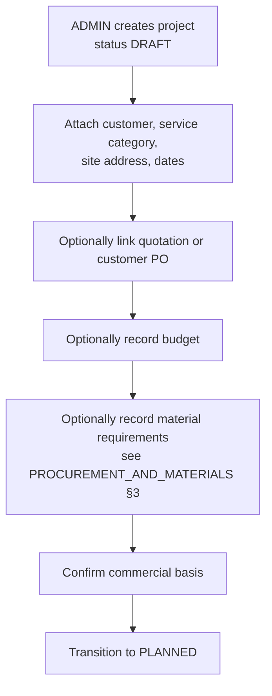
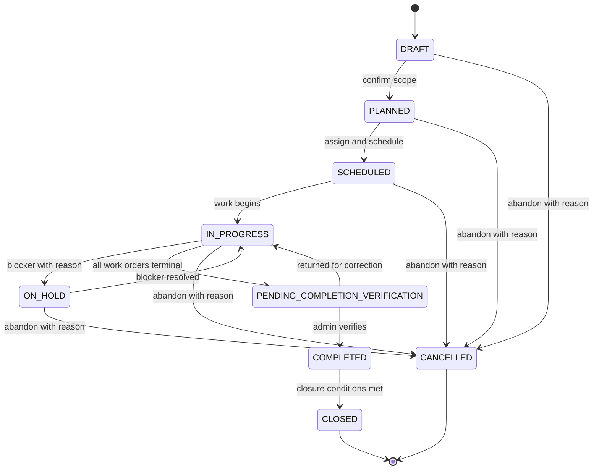
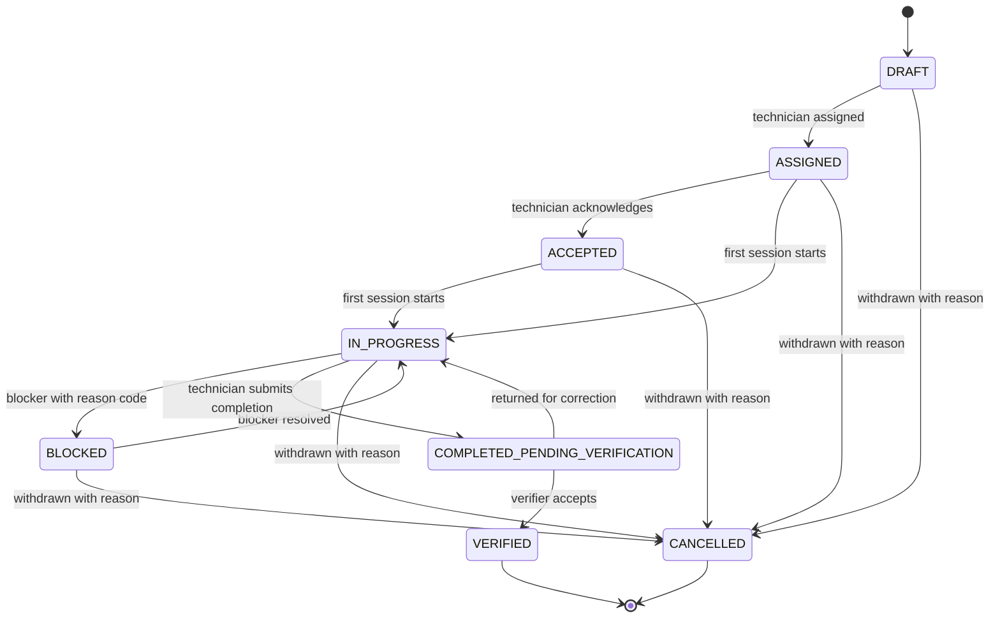
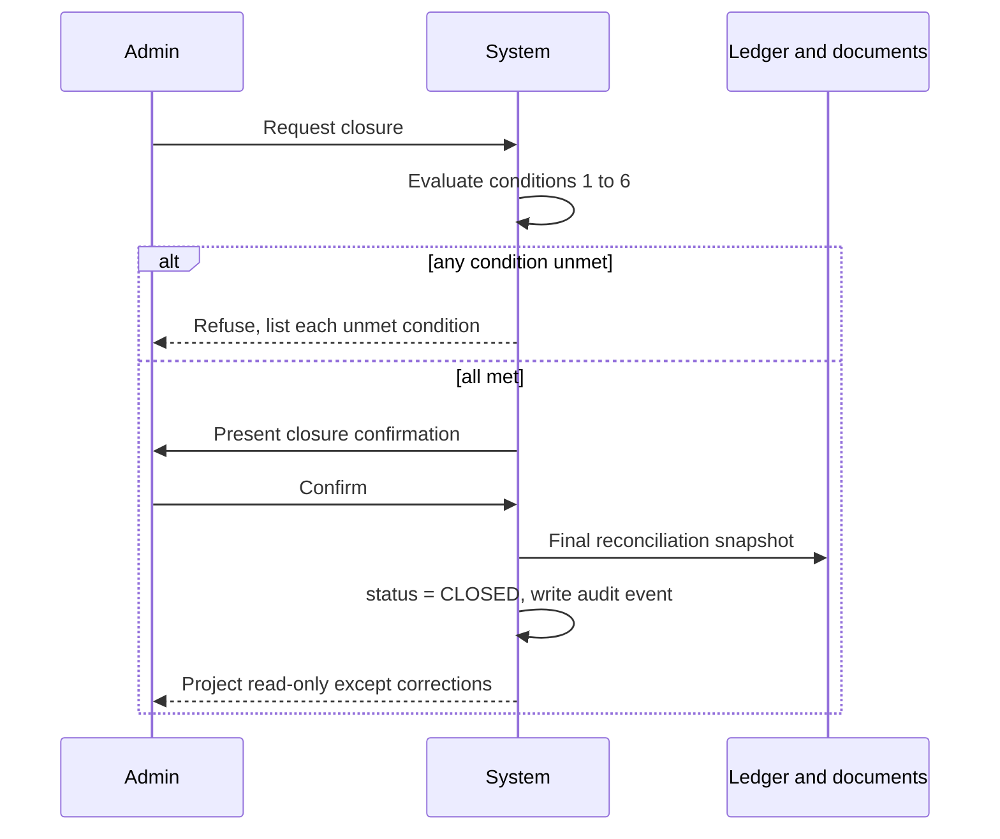

# Project Lifecycle — WJ-CCTV Business Operations System

| Field | Value |
|---|---|
| Status | Target design |
| Version | 0.2 — reconciled 2026-10-25 |
| Scope owner | The **project status** and **work-order status** state machines, project creation, scheduling, closure |
| Requirement source | [`../PRD.md`](../PRD.md) §6.2, §9.1, §9.2, §8 |
| Related | [`./TECHNICIAN_OPERATIONS.md`](./TECHNICIAN_OPERATIONS.md), [`./PROCUREMENT_AND_MATERIALS.md`](./PROCUREMENT_AND_MATERIALS.md), [`./FINANCE_AND_DOCUMENTS.md`](./FINANCE_AND_DOCUMENTS.md) |

---

## 1. Core principle: independent state machines

**[Confirmed]** Projects span multiple days and involve one or many technicians, which makes a binary completed/not-completed model unusable. The system maintains **four** separate state machines, never collapsed into one another (BR-PROJ-002):

| # | State machine | Owner | Answers |
|---|---|---|---|
| 1 | **Project status** | §3 | Where is the engagement as a business commitment? |
| 2 | **Work-order status** | §5 (detail in TECHNICIAN_OPERATIONS) | Where is the individual technician's task? |
| 3 | **Work-session state** | TECHNICIAN_OPERATIONS §3 | Is the technician working right now, and since when? |
| 4 | **Material readiness** | PROCUREMENT_AND_MATERIALS §7 | Can the work physically proceed? |

**Why they must stay separate:** a project can be `IN_PROGRESS` with materials `AWAITING_PROCUREMENT` (work started on the accessible portion) · all work orders `VERIFIED` while materials remain `PARTIALLY_ISSUED` (leftover not yet returned) · readiness `READY_TO_START` for a project still `SCHEDULED` (everything staged, nobody on site) · a technician `ACTIVE` in a session on a work order that is `BLOCKED` pending an earlier blocker. Any design inferring one from another produces false states.

**The only sanctioned coupling** is BR-PROJ-003: entering `IN_PROGRESS` while readiness is not `READY_TO_START` requires a recorded override with reason.

---

## 2. Project creation

### 2.1 Required

Customer (FR-PROJ-001) · service category (FR-PROJ-002, driving no CCTV assumptions) · title · **site address** (FR-PROJ-013) · planned start · target completion (≥ planned start) · owner of record among office staff.

### 2.2 Optional — and stays optional

Quotation reference (FR-PROJ-003 — many small jobs never get one) · customer PO (FR-PROJ-004) · budget (FR-PROJ-008) · material requirement lines (some services need none) · technician assignments (assigned after scoping) · schedule detail · **site coordinates** (the project works without a map).

**BR-PROJ-001 is binding:** no step may be forced merely because the system supports it. A one-day, no-material, single-technician job must be creatable, executable, billable, and closable without ever touching quotation, customer PO, purchase request, or material screens (AC-PROJ-001).

### 2.3 Creation sequence

`DRAFT` is intentionally permissive — a working area. Validation that matters (dates, category, customer) applies at `PLANNED`.

---

## 3. Project status state machine

Statuses are defined in [`../PRD.md`](../PRD.md) §9.1 and reused verbatim.

### 3.1 Transition table (authoritative)

| From | To | Trigger / condition | Actor | Side effects |
|---|---|---|---|---|
| `DRAFT` | `PLANNED` | Required fields complete; commercial basis confirmed | `ADMIN`, `PEMILIK`, `SUPER_ADMIN` | Project appears in operational lists |
| `PLANNED` | `SCHEDULED` | ≥1 technician assigned AND planned dates set | Same | Assignment records created; technician sees project |
| `SCHEDULED` | `IN_PROGRESS` | Work has begun on site | Same | `actual_start_date` set; readiness override required if not `READY_TO_START` |
| `IN_PROGRESS` | `ON_HOLD` | Blocker requiring suspension | Same | Blocker reason recorded (FR-TECH-006); open work orders → `BLOCKED`; active sessions must be ended |
| `ON_HOLD` | `IN_PROGRESS` | Blocker resolved | Same | Blocker closure note recorded |
| `IN_PROGRESS` | `PENDING_COMPLETION_VERIFICATION` | All work orders `VERIFIED` or `CANCELLED` | **System-derived** | Not manually settable |
| `PENDING_COMPLETION_VERIFICATION` | `IN_PROGRESS` | Verification returned for correction | Same | Reason required; the relevant work order returns to `IN_PROGRESS` (FR-TECH-013) |
| `PENDING_COMPLETION_VERIFICATION` | `COMPLETED` | Office verifies completion | Same | `actual_completion_date` set; billing may proceed |
| `COMPLETED` | `CLOSED` | All closure conditions met (§6) | Same | Project becomes read-only except corrections |
| `DRAFT`/`PLANNED`/`SCHEDULED`/`IN_PROGRESS`/`ON_HOLD` | `CANCELLED` | Abandoned with reason | `PEMILIK`, `ADMIN` | Reason required; records retained (BR-PROJ-005) |
| `PENDING_COMPLETION_VERIFICATION`/`COMPLETED` | `CANCELLED` | **Not permitted** | — | Work already performed; use `CLOSED` with a note, or credit the invoice |

### 3.2 State diagram

The table is authoritative because it carries actor, guard, and side effects; the diagram is a navigation aid.

### 3.3 Rejected transitions

Refused with the current status and permitted next statuses named (FR-PROJ-011): `DRAFT` → `IN_PROGRESS` (skipping planning and scheduling) · `SCHEDULED` → `COMPLETED` (skipping execution and verification) · `COMPLETED` → `IN_PROGRESS` (reopening; use a linked follow-up or an explicit recorded correction) · `CLOSED` → anything (terminal) · `CANCELLED` → anything (terminal) · any manual set of `PENDING_COMPLETION_VERIFICATION`.

**[Open Question] Q-PROJ-01 — Reopening a closed project.** Businesses do reopen jobs (a warranty fault). **Proposed default:** do not reopen; create a new project linked via `related_project_id`, preserving the closed project's financial history. **Rationale:** reopening invalidates already-issued invoices and closed-period reporting. **Decision trigger:** Phase 0.

---

## 4. Scheduling and assignment

A project may have **one or many** technicians (FR-PROJ-007) — both extremes are normal. At most **one** technician may be designated team leader at a time, enforced by a conditional unique index (`UNIQUE (project_id, leader_active_flag)`), not a UI rule. Assignment records are append-only in effect: unassigning sets `unassigned_at` and a reason; the row is never deleted. **The designation is not a role** — it grants two scoped permissions only (SECURITY §4.1).

| Concept | Model |
|---|---|
| Project planned start / target completion | Dates on the project |
| Per-day or per-phase detail | Optional schedule entries (date, technician, planned activity) |
| Actual work | Derived from **work sessions** and submitted daily reports |
| Schedule variance | Derived: actual vs target completion |

A five-day project creates one project, one work order per technician, **one or more sessions per technician per day**, and one daily report per technician per working day — not five projects, five invoices, or five work orders.

Changing planned start or target completion creates a `project_schedule_revisions` row (FR-PROJ-005) capturing previous values, new values, reason, actor, and timestamp. Nothing is overwritten; reports can show "target moved twice, both with reasons".

---

## 5. Work-order status

### 5.1 Transition table

| From | To | Condition | Actor |
|---|---|---|---|
| `DRAFT` | `ASSIGNED` | Technician assigned | `ADMIN`, `SUPER_ADMIN` |
| `ASSIGNED` | `ACCEPTED` | Technician acknowledges | Assigned technician |
| `ASSIGNED`/`ACCEPTED` | `IN_PROGRESS` | First work session started, or first daily report submitted | Assigned technician |
| `IN_PROGRESS` | `BLOCKED` | Blocker recorded with reason code | Assigned technician, `ADMIN` |
| `BLOCKED` | `IN_PROGRESS` | Blocker resolved | Assigned technician, `ADMIN` |
| `IN_PROGRESS` | `COMPLETED_PENDING_VERIFICATION` | Technician submits a completion report | Assigned technician |
| `COMPLETED_PENDING_VERIFICATION` | `VERIFIED` | Authorised verifier accepts completion | `ADMIN`, `PEMILIK`, `SUPER_ADMIN` |
| `COMPLETED_PENDING_VERIFICATION` | `IN_PROGRESS` | Returned for correction, reason mandatory | Verifier |
| Any non-terminal | `CANCELLED` | Withdrawn with reason | `ADMIN`, `PEMILIK`, `SUPER_ADMIN` |

**Terminal states:** `VERIFIED`, `CANCELLED`.

**BR-TECH-002:** the verifier may not be the technician who completed the work, unless an override with reason is recorded. **BR-TECH-005:** submitting completion — or ending a session — never completes the work order or the project; verification does.

### 5.2 State diagram

---

## 6. Closure

### 6.1 Conditions (BR-PROJ-004)

All must hold; the system enumerates any that fail (FR-PROJ-010):

| # | Condition | Rationale |
|---|---|---|
| 1 | Every work order is `VERIFIED` or `CANCELLED` | No work in limbo |
| 2 | No material line is in an open issued state (all consumed, returned, or written off) | Prevents untracked material loss |
| 3 | No invoice is `DRAFT` | Billing decided |
| 4 | Every issued invoice is `PAID`, `VOID`, or `CREDITED` — or explicitly accepted as outstanding with a note | Closure is about work, not payment; outstanding AR is allowed but must be acknowledged |
| 5 | **No work session is `ACTIVE`** | An open session means someone may still be working; closing would freeze a moving record |
| 6 | Any closure override is recorded with reason | Auditability |

**Condition 4 is deliberately permissive.** Requiring full payment before closure would block projects for months over a slow-paying customer and push staff to fake payments. The system allows closure with acknowledged outstanding AR, which then appears in the ageing report (FR-FIN-005).

### 6.2 Closure sequence

### 6.3 After closure

Editing scope, dates, or assignment is **not** permitted; neither is adding a daily report or starting a session. **Permitted:** issuing an invoice for unbilled work (closure is about work, not billing completeness) · recording a payment against an existing invoice · issuing a credit note · correcting a material movement with audit. Deleting anything is never permitted.

**[Open Question] Q-PROJ-02 — Should closure block on unbilled work?** **Proposed default:** no — warn if work orders lack invoice coverage, but allow closure. **Rationale:** forcing billing completeness at closure pressures staff to issue invoices prematurely; a warning plus a monthly unbilled-work report is a better control.

---

## 7. Cancellation

Cancelling is a business decision with financial consequences, so it is constrained: it requires a reason code and free-text reason (FR-PROJ-012) · is permitted only before work verification · does **not** delete the project, its documents, POs, payables, or invoices (BR-PROJ-005) · cancels open work orders with the same reason, and **active sessions must be ended or abandoned first** with a recorded reason · releases reserved materials · requires issued materials to still be returned or written off · leaves outstanding supplier payables payable (cancelling a project never cancels a supplier debt) · writes an audit event and leaves the project visible in reports as `CANCELLED`.

**The mistake this prevents:** treating cancellation as a rollback. It is not. Money spent and material issued remain facts.

---

## 8. Interaction with materials and finance

| Event | Material effect | Finance effect |
|---|---|---|
| `PLANNED` | Requirements may be recorded | Quotation may be issued |
| `SCHEDULED` | Reservations may be created; purchasing may proceed | — |
| `IN_PROGRESS` | Materials issued as needed; sessions recorded | — |
| `PENDING_COMPLETION_VERIFICATION` | Remaining material returned or written off | Invoice may be issued |
| `COMPLETED` | Reconciliation runs | Invoices issued, payments recorded |
| `CLOSED` | Read-only | Payments continue; corrections only |
| `CANCELLED` | Reservations released; issued material must be resolved | Outstanding invoices/payables persist |

**No step is automatic across domains.** Issuing an invoice does not change project status; closing a project does not mark an invoice paid. Each domain acts on its own state machine, and the UI presents them side by side.

---

## 9. Reporting derived from lifecycle

Projects by status · schedule variance (target vs actual) · blocked work orders · projects awaiting verification · unbilled completed work · cancelled-project impact (spend or issued material) · **session hours per project** (sum of completed session durations, FR-RPT-006).

---

## 10. Acceptance criteria references

| Behaviour | AC |
|---|---|
| Project creatable without quotation/PO/materials/multiple technicians | AC-PROJ-001 |
| Service category drives no CCTV assumptions | AC-PROJ-002 |
| Optional links truly optional | AC-PROJ-003, AC-PROJ-004 |
| Schedule revision recorded, not overwritten | AC-PROJ-005 |
| Multi-day progress not binary | AC-PROJ-006 |
| One-or-many technician assignment; single team leader | AC-PROJ-007 |
| Closure refused with enumerated unmet conditions, including an active session | AC-PROJ-010 |
| Illegal transitions refused with permitted options named | AC-PROJ-011 |
| Cancellation retains all records | AC-PROJ-012 |
| Verification by another user, override when not | AC-TECH-008, AC-AUD-004 |
| Project location optional; map degrades gracefully | AC-MAP-001 |

---

## 11. Cross-references

- Status definitions: [`../PRD.md`](../PRD.md) §9.1, §9.2
- Field execution, sessions, verification: [`./TECHNICIAN_OPERATIONS.md`](./TECHNICIAN_OPERATIONS.md)
- Material readiness: [`./PROCUREMENT_AND_MATERIALS.md`](./PROCUREMENT_AND_MATERIALS.md)
- Billing after completion: [`./FINANCE_AND_DOCUMENTS.md`](./FINANCE_AND_DOCUMENTS.md)
- Who may transition: [`../architecture/SECURITY_AND_ACCESS_CONTROL.md`](../architecture/SECURITY_AND_ACCESS_CONTROL.md) §5
