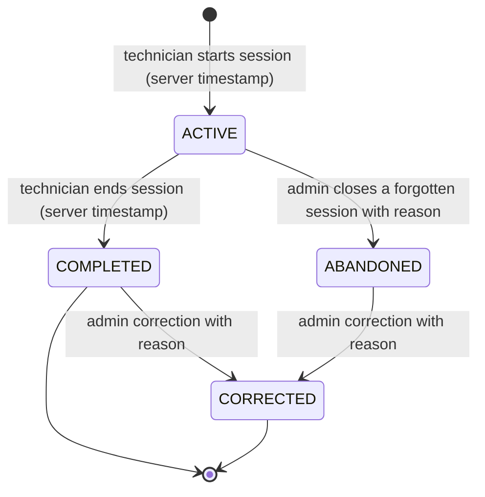
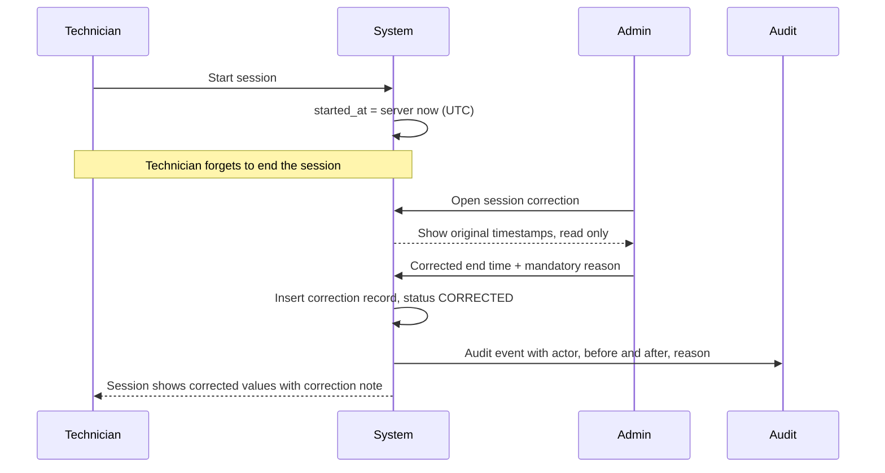
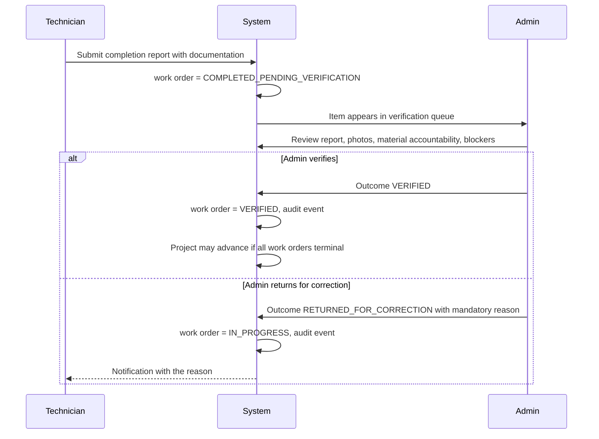
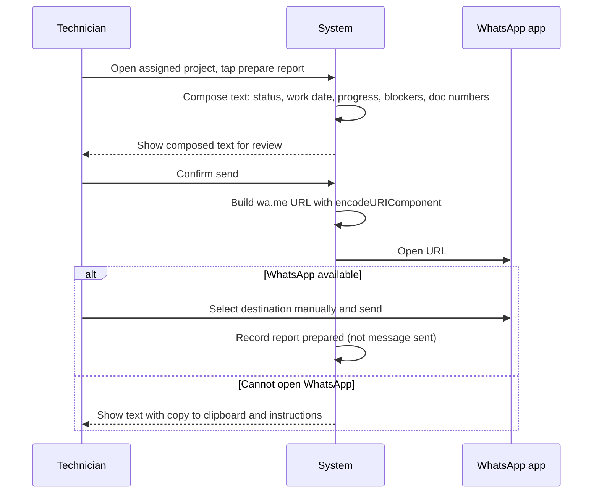

# Technician Operations — WJ-CCTV Business Operations System

| Field | Value |
|---|---|
| Status | Target design |
| Version | 0.2 — work sessions and verification reconciled 2026-10-25 |
| Scope owner | Scheduling, assignment, **work sessions**, daily reporting, evidence, blockers, completion verification, WhatsApp preparation, field UX |
| Requirement source | [`../PRD.md`](../PRD.md) §6.5, §9.2, §9.11, §9.14, §9.15, §6.11 |
| Related | [`./PROJECT_LIFECYCLE.md`](./PROJECT_LIFECYCLE.md) (project and work-order state machines) |

---

## 1. Confirmed reality

**[Confirmed]:** ~15 technicians · the owner assigns per project, one technician or a larger team · projects span multiple days with work happening in discrete sessions · technicians currently report via **WhatsApp groups**.

**[Assumption]** A-01: technicians have smartphones with a modern browser and intermittent mobile data. If false, the field design fails and a native/offline approach becomes necessary. The single assumption most worth validating early (Phase 0).

| WhatsApp does well | WhatsApp fails at |
|---|---|
| Zero training; instant; familiar | No structure — a report is a paragraph |
| Photos are trivial | No link between a photo and a work order |
| Works on any phone; group visibility | No status, no verification, no audit |
| — | No way to answer "which jobs are done?" |
| — | No record of when work actually started or ended |
| — | Office must re-type everything into spreadsheets |

**Design implication:** the replacement must be *at least as fast* as typing a WhatsApp message, or technicians will keep using WhatsApp. This is why M3 sets **< 3 minutes on a phone** and why the reporting form is the most UX-critical screen in the product. A successful UI action is not proof the system works — but a slow UI is proof it will not be used.

---

## 2. Platform: mobile-first PWA, online-first

**[Confirmed]** mobile-first responsive web with PWA support; native **[Out of Scope]** (Q-UX-01).

| Criterion | Mobile-first PWA | Native app |
|---|---|---|
| Time to first working version | Low | High |
| Distribution to 15 technicians | Send a link | App store, device compatibility |
| Update cycle | Deploy once | Store review, version fragmentation |
| Weak-signal behaviour | Degrades; local draft preserved | Better offline support |
| Installability | Home-screen install via manifest | Native |
| Push notifications | Not in MVP | Native |
| Cost to maintain | Low | Materially higher |

### 2.1 What the PWA does and does not do

| Does (NFR-OPS-010) | Does **not** (deferred) |
|---|---|
| Installable to the home screen | Offline form submission |
| Versioned static-asset caching | Background sync queue |
| Safe cache versioning and update prompt | Cached authenticated pages or business data |
| Local preservation of an in-progress draft | Guaranteed draft survival across logout or device change |

**MVP is online-first.** The service worker caches only versioned static assets — **never** authenticated HTML or JSON, private files, or anything fetched with a session credential (FR-PWA-002, AC-PWA-002).

### 2.2 Field UX constraints

360 px single-column layout, no horizontal scroll, no data tables in field flows · ≥44 px touch targets, no hover-dependent interaction · lightweight pages, draft preserved locally, explicit retry, no silent data loss · high contrast for sunlight · primary actions within thumb reach · all labels and messages in Indonesian (NFR-OPS-007) · client-side image compression for limited data plans · large buttons for gloves and wet hands.

---

## 3. Work sessions

**A work session is a first-class entity (FR-TECH-011).** It answers "when did this technician actually work on this project?" — a question the current WhatsApp process cannot answer at all.

### 3.1 Why a session, not just a report

One start and one completion per project is **explicitly insufficient**: a three-day project with two technicians has at least six sessions, and a technician may work a morning and an evening on the same day. Project-level timestamps would force fabricated data and make duration reporting meaningless.

A session is separate from the **daily report**: a report describes what was done; a session records that work was happening between two instants. One report may cover two sessions; two reports may fall within one long session.

### 3.2 Session fields

| Field | Source | Mutable? |
|---|---|---|
| Start timestamp | **Server clock at start** | **No** — never by the technician |
| Completion timestamp | **Server clock at end** | **No** — never by the technician |
| Technician identity | Session owner | No |
| Project and work-order reference | Derived from assignment | No |
| Linked progress reports | Reports submitted during the session | Links only |
| Documentation | Photos and attachments captured | Links only |
| Status | `ACTIVE`, `COMPLETED`, `CORRECTED`, `ABANDONED` | State machine only |

### 3.3 Session state machine

| From | To | Trigger | Actor | Rule |
|---|---|---|---|---|
| — | `ACTIVE` | Start session | Assigned `TEKNISI` | At most one `ACTIVE` session per technician |
| `ACTIVE` | `COMPLETED` | End session | Assigned `TEKNISI` | Server writes `ended_at` |
| `ACTIVE` | `ABANDONED` | Forgotten session closed | `ADMIN`, `SUPER_ADMIN` | Reason mandatory; both timestamps attributed to the correction |
| `COMPLETED`/`ABANDONED` | `CORRECTED` | Timestamp or attribution corrected | `ADMIN`, `SUPER_ADMIN` | Reason mandatory; **original retained** |

**A session is never deleted.**

### 3.4 Timestamp authority and correction

**The server is authoritative** (FR-TECH-012, BR-TECH-004). Start is written when the technician taps start; completion when they tap end. The technician cannot send a chosen time, and neither value is editable through any route, API, or Blade form. Rendering is `Asia/Jakarta`; storage is UTC with millisecond precision (NFR-OPS-009).

The original row keeps its values; the correction is a **new, attributed record**. Reports show both. This is what makes "the technician cannot backdate" a fact rather than a policy statement.

### 3.5 Interaction with status

| Event | Work order | Project |
|---|---|---|
| First session starts | `ASSIGNED`/`ACCEPTED` → `IN_PROGRESS` | Unchanged |
| Session ends | Unchanged | Unchanged |
| All sessions ended, completion submitted | → `COMPLETED_PENDING_VERIFICATION` | Unchanged |
| Verification accepted | → `VERIFIED` | May advance when all work orders terminal |

**Ending a session never completes anything.** That is BR-TECH-005, and it is the rule that stops a technician's own click from closing a project.

---

## 4. Technician and team model

| Record | Content |
|---|---|
| Technician | Name, phone, active status, skills where known, linked user account |
| Project member | Project, technician, `is_team_leader` flag, assigned by/at, unassigned at |
| Work order | One per technician per project (or per phase), planned dates, scope, status |
| Work session | Start, completion, technician, project, work order |

Both assignment extremes are normal (FR-PROJ-007): one technician → one assignment, one work order, sessions as needed; a team of N → N assignments, N work orders, at most one team-leader designation.

Each technician gets their **own** work order even when working the same project on the same day, because completion, daily reports, material custody, and verification are all per-person. A shared work order would make all four impossible.

**Team-leader designation — not a role** (PRD §4.2, SECURITY §4.1). `project_members.is_team_leader` grants exactly two capabilities on that project:

| Capability | Granted? |
|---|---|
| Submit one team-level daily summary | Yes |
| See teammates' reports and work orders on that project | Yes |
| Verify a teammate's completion | **No** |
| Issue material to teammates | **No** (office function) |
| See financial data / other projects | **No** |

**[Open Question] Q-ROLE-01** — whether the designation should survive at all. **Proposed default:** keep it for site accountability. **Decision trigger:** Phase 0 — if all technicians report directly to the office, retain the designation but drop the review capability.

---

## 5. Daily work report

### 5.1 The core field interaction

| Field | Type | Notes |
|---|---|---|
| Date | Date, defaults to today | Business date, not timestamp |
| Project / work order | Pre-selected from assignment | Technician does not search |
| Work session | Pre-selected if active; otherwise optional link | Ties the report to when work happened |
| Work performed | Free text | Fast to type; no forced taxonomy |
| Progress indicator | Selection | §5.3 |
| Material used | Optional, pre-filled from issued material | Technician confirms quantities |
| Photos | Optional, up to a configured limit | Camera capture or gallery |
| Blocker | Optional | Reason code + note |

**Design rules:** pre-fill everything derivable (project, work order, date, session, issued materials) · free text for work performed — a dropdown of activity types produces "other" for everything · photos must not block submission · preserve the draft locally (FR-PWA-004) · no more than one screen of required input.

### 5.2 Report lifecycle

`DRAFT` (started; local only until submitted) → `SUBMITTED` (received, visible to office) → `REVIEWED` (acknowledged) or `REJECTED` (returned with a reason).

**BR-TECH-003:** a submitted report is never edited. A correction is a **new version** that supersedes the original; the original remains retrievable — precisely what WhatsApp scrollback cannot do.

**Local draft boundary (FR-PWA-004).** The draft lives in `localStorage`/`IndexedDB` on that device. It is **not** a submitted record, is not visible to the office, and may be lost on logout or device change (**Q-PWA-01**). The UI must say so plainly rather than implying the draft is safe.

### 5.3 Progress indicator

FR-TECH-010 requires progress to be an **estimate**. Free percentage entry is easy but wildly inconsistent and creates false precision; milestone checklists are consistent but need per-project setup; **coarse bands** (not started / quarter / half / mostly / done) are **[Proposed]** — low friction and honest about imprecision.

Progress displays as "perkiraan" (estimate) with a last-updated timestamp, never as the authoritative completion measure — that is the verification step.

### 5.4 Evidence and photos

Private local disk outside the webroot; never public (FR-DOC-001) · served through an authorising route, streamed with `Content-Disposition` (NFR-SEC-010) · configurable per-file size, per-report count, and image dimensions, enforced **server-side** (FR-TECH-005) · MIME sniffing, extension allow-list, dimension sanity check, filename sanitisation · metadata records uploader, timestamp, SHA-256, and the linked report and session · retention follows the project · client-side downscale respects data plans.

Photos are the evidence that work was done and the single most valuable thing WhatsApp provides today. Linking them to a work order and a session — rather than leaving them in a chat — is the improvement.

### 5.5 Blockers

Reason codes: `MATERIAL_NOT_AVAILABLE` · `SITE_NOT_READY` · `CUSTOMER_REQUEST` · `WEATHER` · `EQUIPMENT_FAULT` · `ACCESS_DENIED` · `OTHER` (with note).

A blocker sets the work order to `BLOCKED` and surfaces it to office staff immediately (FR-TECH-006), appearing in a dedicated office view and the daily summary. A blocker buried in a group chat is discovered when someone reads the chat; a blocker in the system is a list item that persists until resolved.

---

## 6. Completion submission and verification

**A technician finishing work does not complete the project** (FR-TECH-013, BR-TECH-005).

| Outcome | Effect | Reason required |
|---|---|---|
| `VERIFIED` | Work order → `VERIFIED`; project may advance | No |
| `RETURNED_FOR_CORRECTION` | Work order → `IN_PROGRESS`; technician sees why | **Yes** |

Both outcomes are audited with actor, timestamp, and outcome (PRD §9.15).

**Verification guidance** (not enforced fields): work matches scope, photos present, material accounted for, no unresolved blocker, sessions recorded for the reported work.

**BR-TECH-002:** the verifier must not be the technician who completed the work. If the only available verifier is that technician, an override with reason is required and appears in the `PEMILIK` override report.

**Multi-day and partial completion:** a five-day job produces **one** work order per technician, `IN_PROGRESS` across all days, with multiple sessions and daily reports. One technician may reach `COMPLETED_PENDING_VERIFICATION` while others continue; the project stays `IN_PROGRESS`. **The project does not become `COMPLETED` when one work order is verified** — only when all are terminal.

---

## 7. Scheduling, rescheduling, reassignment

Per-technician planned dates sit on the work order; the project carries the span. **[Proposed]** warn when a technician is assigned to overlapping projects but do not block — with 15 technicians and urgent jobs the owner sometimes knowingly double-books, and a hard block would be overridden constantly and train users to ignore warnings.

**Rescheduling** (FR-TECH-007) requires a reason and is recorded; previous dates are not overwritten.

**Reassignment** requires a reason; the new technician sees it and the old one loses access. **Material issued to the previous technician does not automatically transfer** — custody is per-person, so the office records a return and a new issue, or an explicit custody transfer. Silently moving custody would break the ledger's accountability. This friction reflects reality: material held by one person does not teleport when a task is reassigned.

**Open sessions on reassignment:** an `ACTIVE` session must be ended or abandoned first, otherwise it would outlive the technician's access.

---

## 8. Office oversight

| View | Purpose |
|---|---|
| Work orders active today | Who is where |
| **Sessions active now** | Who is currently working, and since when |
| Work orders with no report today | Early warning of silence |
| Blocked work orders | Needs action |
| Awaiting verification | Office work queue |
| Projects starting/ending this week | Planning |
| **Forgotten sessions** | Active longer than a configurable threshold |

**[Proposed] detection:** a work order `IN_PROGRESS` with no daily report for a configurable period (default one working day) appears in an exception list; a session `ACTIVE` beyond a threshold (default 12 hours) appears in a separate list.

**Rationale:** the current failure mode is not wrong reports — it is *no* reports, discovered days later. Detection converts an invisible problem into a visible one. It is a report, not an automatic status change; the office decides what it means.

---

## 9. WhatsApp report preparation

**MVP = prefilled message, technician reviews and sends manually** (FR-WA-001…003). No automatic group posting, no delivery claims, no WhatsApp Business API.

| Included | Excluded |
|---|---|
| Current project and work-order status | Any invoice amount, payment, or margin figure |
| Work date and progress summary (estimate) | Internal URLs requiring authentication |
| Blockers | Private storage links |
| Documentation references as **human-readable document numbers** | Any credential or token |

**URL construction:** `https://wa.me/?text=` with `encodeURIComponent`; practical length limit roughly **2000 characters** — the composed text is truncated with a visible notice rather than silently cut. The destination is **selected manually** by default (**Q-WA-01**; proposed default: manual, because group IDs are not reliably available without the Business API).

**Semantics:** the system records "report prepared" with a timestamp and content hash. It never claims "message sent", delivery, or a read receipt. An optional "mark as sent" is an **unverified self-declaration** and must be labelled as such. When WhatsApp cannot be opened — no app, desktop browser, popup blocked — the composed text is shown with a **copy-to-clipboard fallback and instructions**; the system never fails silently.

---

## 10. Maps for field work

OpenStreetMap tiles via Leaflet when coordinates exist, with visible attribution (FR-MAP-001) · no coordinates → address plus a placeholder, never an error or blank frame · "Open directions" launches a Google Maps URL with **no API key** (FR-MAP-002) · **routing is not in scope** — OSM tiles carry no routing engine · no bulk downloading, no heavy caching, configurable tile source (FR-MAP-003, Q-MAP-01) · coordinates are business-confidential and reach a third party only when the technician taps the directions link.

---

## 11. Access scope

FR-TECH-009 and NFR-SEC-006 are absolute.

| A technician can | A technician cannot |
|---|---|
| See own assigned projects and work orders | See other technicians' assignments |
| Start and end own work sessions | Alter any session timestamp |
| Submit own daily reports and uploads | See any invoice, payment, supplier, or settings data |
| See materials issued to them | See company-wide reports |
| Record consumption/return of own issued material | Approve purchases or issue documents |
| Raise an additional material request on own project | Change project status |
| Prepare a WhatsApp report for own project | Verify own completion |
| — | See other technicians' personal data |

**Structural enforcement:** technician-facing queries are dedicated scoped functions, not general queries with an optional filter (SECURITY §4). A missing filter must be impossible, not merely unlikely. A technician seeing invoice values would learn the company's margins on their own work — a real commercial risk in a 15-person team.

---

## 12. Failure behaviours

| Failure | Required behaviour |
|---|---|
| Photo upload fails | Report submits; photo marked failed with retry; no data loss |
| Connection drops mid-form | Draft preserved locally; resubmission offered; the draft is not a submitted record |
| Duplicate submission (double tap) | Idempotent; one report created (Turbo handlers must not double-bind — ARCHITECTURE §3.2) |
| Report submitted for the wrong date | New version supersedes; original retained (BR-TECH-003) |
| Technician forgets to end a session | Forgotten-session list; `ADMIN` closes it as `ABANDONED` with reason; original timestamps retained |
| Technician attempts to backdate a session | Refused — the field is server-written and absent from every form |
| Technician unassigned after starting work | Submitted reports remain; an active session must be closed first |
| Material issue disputed by technician | Office records an adjustment with reason; audit shows both |
| Work order verified then found incomplete | New work order created linked to the project; verified record stands |
| WhatsApp cannot open | Composed text with copy fallback and instructions |

**No failure may result in silent data loss.** That is the minimum standard, and it is the standard WhatsApp fails at.

---

## 13. Acceptance criteria references

| Behaviour | AC |
|---|---|
| Technician linked to exactly one user | AC-TECH-001 |
| Team-leader designation scoped, two capabilities only | AC-TECH-002 |
| One work order per technician | AC-TECH-003 |
| Daily report in < 3 minutes at 360 px | AC-TECH-004 |
| Photo upload with server-side limits | AC-TECH-005 |
| Blocker recorded and surfaced | AC-TECH-006 |
| Reschedule/reassign recorded; custody not auto-transferred | AC-TECH-007 |
| Partial completion and return for correction | AC-TECH-008 |
| Technician sees only own assignments | AC-TECH-009 |
| Progress presented as estimate | AC-TECH-010 |
| **Many sessions per project; one start per project insufficient** | AC-TECH-011 |
| **Session timestamps immutable; correction audited with reason** | AC-TECH-012 |
| **Verification decision audited; return requires a reason** | AC-TECH-013 |
| WhatsApp text correct, encoded, no financial data | AC-WA-001, AC-WA-002 |
| Manual send semantics; prepared ≠ sent; copy fallback | AC-WA-003 |
| Map placeholder without coordinates; directions link | AC-MAP-001, AC-MAP-002 |
| Local draft preserved on interruption, never submitted | AC-PWA-004 |
| Multiple technicians on one project | AC-PROJ-007 |
| Multi-day reports accumulate | AC-PROJ-006 |

---

## 14. Cross-references

- Work-order state machine: [`./PROJECT_LIFECYCLE.md`](./PROJECT_LIFECYCLE.md) §5
- Material issue/return: [`./PROCUREMENT_AND_MATERIALS.md`](./PROCUREMENT_AND_MATERIALS.md) §6
- Permissions: [`../architecture/SECURITY_AND_ACCESS_CONTROL.md`](../architecture/SECURITY_AND_ACCESS_CONTROL.md) §3, §4
- Session entities: [`../architecture/DATA_MODEL.md`](../architecture/DATA_MODEL.md) §4
- Turbo initialisation: [`../architecture/ARCHITECTURE.md`](../architecture/ARCHITECTURE.md) §3.2
- Mobile targets: [`../PRD.md`](../PRD.md) NFR-OPS-003, NFR-OPS-004
